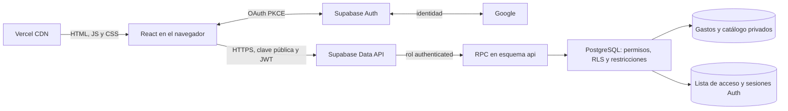
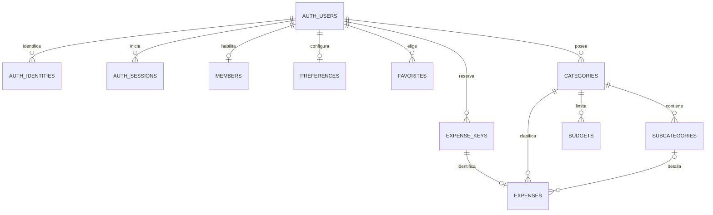

# ARCH-01 · Arquitectura técnica de la V1

**Propuesta para aprobación · 23 de noviembre de 2026.** Aplicación privada de gastos personales, inicialmente para dos identidades Google. El diseño admite el volumen de cuatro personas durante años. La autorización inicial sigue limitada a dos. La [especificación funcional](requisitos-v1.md) gobierna el alcance y los criterios de aceptación.

## 1. Recomendación y decisión de alcance

**Recomiendo React + Vite en Vercel, Supabase Auth con Google y acceso a PostgreSQL mediante la Data API de Supabase.** El registro de un gasto, la comprobación de su categoría y su persistencia caben en una transacción. PostgreSQL también puede devolver los cinco puntos del gráfico anual con una sola consulta. Express y Sequelize añadirían otro servicio desplegable para transportar esos mismos datos.

**Pendiente de aprobación.** Sustituir Express y Sequelize por funciones SQL expuestas mediante PostgREST, con autorización en PostgreSQL. El cambio afecta al stack y al mecanismo explícito de RF-003 y D-05, así como a la condición de calidad que exige rutas privadas de Express. Se conserva su resultado observable: Google, dos UUID habilitados, sesión válida y comprobación de propiedad en cada operación. Mientras se resuelve esta propuesta, sigue vigente la arquitectura aprobada con Express. La implementación de B requiere aprobación y posterior alineación del texto funcional en una tarea autorizada.

| Decisión funcional aprobada | Compromiso del diseño |
| --- | --- |
| D-01 · Monedas | UYU, USD y EUR. Una preferencia privada para las tres pantallas. Cada consulta agregada requiere una moneda. |
| D-02 · Clasificación | Catálogo propio de dos niveles, 13 categorías iniciales, renombrado, archivo y restauración con identidad estable. |
| D-03 · Presupuestos | Un límite vigente por categoría y moneda. Consumo del mes actual derivado de gastos. |
| D-04 · Estadísticas | Indicadores, barras, comparación, línea anual navegable, detalle, resumen y favoritos. |
| D-05 · Acceso | Alta inicial controlada, autorización por UUID y salida verificable. Solo cambia el componente que hace cumplir la autorización si se aprueba B. |

## 2. Comparación de arquitecturas y alojamiento

| Criterio para 2–4 usuarios | A · React → Express → Sequelize → PostgreSQL | B · React → Data API → PostgreSQL |
| --- | --- | --- |
| Implementación | API Node, middleware de token/lista, rutas, validadores, modelos y migraciones. | Cliente JS, contratos RPC y migraciones SQL con permisos. Se necesita conocimiento de RLS. |
| Código y diagnóstico | El servidor JS centraliza reglas y logs. Hay que mantener DTO, modelos, pool y versiones compatibles. | La misma migración versiona restricciones y funciones. Un error de permisos se investiga en SQL/PostgREST. |
| Privacidad | Cada ruta comprueba token, sesión, lista y propietario. Un rol DB demasiado amplio anula la defensa adicional. | El gateway verifica el JWT y el motor comprueba sesión, lista y propietario. Un permiso mal concedido afecta directamente a la superficie pública. |
| Móvil | Puede agrupar toda una pantalla en una respuesta compacta. El ORM queda en el servidor. | Un RPC igualmente compacto por consulta analítica. El móvil recibe agregados, sin recorrer el historial. |
| Latencia efectiva | Viaje hasta la función Vercel, posible arranque, viaje regional a la DB y adquisición de conexión. Puede ser rápido con región próxima y pool. | Una solicitud al origen Supabase tras descargar la SPA. Influyen región, TLS, consulta y tamaño. La pausa del proyecto afecta a ambas. No hay mediciones de la aplicación aún. |
| Estadísticas | SQL parametrizado para series con huecos y comparaciones. El ORM aporta poco a esas consultas. | El mismo SQL se publica como RPC con filtros tipados. El plan se inspecciona directamente en PostgreSQL. |
| Vercel | Express se ejecuta como Vercel Function. Dimensionar conexiones para concurrencia y usar el pooler adecuado. | Vercel sirve archivos estáticos y resuelve rutas SPA. Las solicitudes de datos van a Supabase. |
| Costo | Puede caber en Hobby y Free. Cuenta también el uso/límites de funciones y conexiones. | Puede caber en los mismos planes. Quedan transferencia web, egreso, almacenamiento y cómputo de la DB. |
| Pruebas | Integración HTTP + middleware + DB real y E2E. Mockear Sequelize no prueba aislamiento. | SQL con roles reales + contratos por Data API + E2E. Mockear el SDK no prueba RLS. |
| Migraciones | Coordinar modelos, cambios SQL y despliegue de API. Evitar sincronización automática del esquema en producción. | Un historial SQL en Supabase CLI. Requiere mantener contratos compatibles con clientes abiertos. |
| Comprensión futura | Estructura JS familiar, más lugares para seguir un cambio. Buena opción si surge lógica privada externa. | Cada pantalla tiene un servicio y cada operación, un contrato SQL localizable. RLS compartida y matriz de permisos explícita. |

**Propuesta.** Elegir B. El caso decisivo es que todas las operaciones privadas de V1 son sobre datos relacionales de un solo propietario. La ventaja de A sería coordinar otros servicios o secretos de negocio en un servidor, capacidad que esta V1 no necesita. Ambas alternativas son viables en Vercel. [Vite en Vercel](https://vercel.com/docs/frameworks/frontend/vite) · [Express en Vercel](https://vercel.com/docs/frameworks/backend/express) · [Conexiones PostgreSQL de Supabase](https://supabase.com/docs/guides/database/connecting-to-postgres).

### Base de datos, disponibilidad y costo

| Dimensión | PostgreSQL en Supabase | SQLite alojada, por ejemplo Cloudflare D1 |
| --- | --- | --- |
| Administración y acceso | Auth, gateway, Postgres, roles, RLS y herramientas de migración integrados. | D1 administra la base. Hace falta un Worker/API que valide la sesión Google/Supabase y aplique propiedad en cada consulta. El archivo SQLite local de una función Vercel no sustituye almacenamiento durable. |
| Exactitud e histórico | NUMERIC exacto, FK compuestas, agregaciones, calendarios SQL e índices por período. | Es viable con centésimos enteros, índices y agregaciones SQL. Requiere otro diseño para autorización y calendarios. |
| Latencia y disponibilidad | Elegir una región cercana a Uruguay disponible en el plan y medir. Free puede requerir reactivación administrativa. | El cómputo de D1 escala a cero. La red Worker–base y la ubicación de los datos siguen contando. La ventaja concreta es el modelo de inactividad, no una aceleración demostrada. |
| Costo publicado | Free USD 0, hasta 500 MB de DB por proyecto, 50.000 usuarios activos mensuales y 5 GB de egreso incluidos, hasta dos proyectos activos gratuitos. | Workers Free incluye 5 millones de filas leídas y 100.000 escritas por día y 5 GB totales de almacenamiento. También aplican los límites del Worker. |
| Recuperación | En Pro, copias diarias consultables de los últimos siete días. En Free, conservar copias externas verificadas. | D1 ofrece Time Travel a un punto de los últimos siete días en Free, 30 en Paid. Hay que conservar también configuración y acceso a la identidad externa. |

**Verificada.** Con uso personal no comercial y dentro de cuotas, Vercel Hobby + Supabase Free puede costar USD 0/mes. El número de usuarios por sí solo no determina la factura. Para un proyecto Micro, Pro parte de USD 25/mes con el crédito de cómputo incluido, antes de adicionales, excedentes e impuestos. Con Free, poca actividad durante siete días puede pausar el proyecto incluso con algún uso ocasional. La guía específica vigente indica hasta un año desde la pausa para reactivarlo en Studio. Después, la recuperación depende del backup aún disponible y de migrar a otro proyecto antes de que se elimine. Comprobar avisos y fecha real en Studio. [Precios de Supabase](https://supabase.com/pricing) · [Pausa y reactivación](https://supabase.com/docs/guides/platform/free-project-pausing) · [Recuperación tras una pausa prolongada](https://supabase.com/kb/troubleshooting/restore-project-after-90-days-pause) · [Vercel Hobby](https://vercel.com/docs/plans/hobby) · [Precios D1](https://developers.cloudflare.com/d1/platform/pricing/) · [Time Travel D1](https://developers.cloudflare.com/d1/reference/time-travel/).

**Propuesta operativa.** Mantener PostgreSQL. Usar Free para desarrollo y pruebas. Para los gastos reales de uso ocasional se recomienda Pro si se necesita acceso sin reactivación manual. Free es viable si el titular acepta la pausa y se ocupa de las copias. Como orden de magnitud, cuatro personas × diez gastos/día × diez años son unos 146.000 gastos. Medir tamaño real de tablas **e índices** con datos representativos y revisar el consumo periódicamente. La conservación durante años depende de mantener el proyecto y copias recuperables. La ventana de siete días de backup no limita la antigüedad de los gastos de una base activa.

El titular conservará una copia lógica cifrada fuera del proveedor semanalmente y antes de migraciones, con cuatro semanales y doce mensuales como propuesta de retención. Con Free y esa frecuencia, una pérdida puede costar hasta una semana de registros. Ensayar trimestralmente una restauración aislada con el procedimiento soportado, incluidos esquema/datos de aplicación, claves foráneas a Auth, identidades, roles/permisos y configuración OAuth separada. Verificar conteos por dueño y moneda, suma por año y nuevo login con el UUID correcto. Los volcados por defecto pueden excluir esquemas gestionados: comprobar contenido y seguir el procedimiento de migración del proveedor para Auth. Los secretos se recuperan desde custodia separada. Esta operación corresponde al titular de la infraestructura. [Copias de Supabase](https://supabase.com/docs/guides/platform/backups) · [Migración y restauración con la CLI](https://supabase.com/docs/guides/platform/migrating-within-supabase/backup-restore).

## 3. Componentes y flujo



La página reúne filtros y componentes. Un hook usa el servicio de su módulo para invocar el SDK, cancelar lecturas obsoletas y traducir respuestas. Una función SQL por operación de negocio valida parámetros y trabaja en una transacción bajo el rol del solicitante. Los triggers de integridad y los permisos protegen también escrituras concurrentes. La BD filtra, agrega y devuelve decimales como texto. React solo formatea y muestra. Una mutación confirmada invalida los datos derivados que pertenecen al mismo usuario.

## 4. Estructura prevista y dependencias

Árbol objetivo de implementación. Los archivos de esta sección se crearán en las etapas de §16.

```text
README.md
docs/{requisitos-v1.md,arquitectura-v1.md}
package.json · package-lock.json · index.html · vite.config.js · vercel.json · .env.example
src/
  main.jsx
  app/{App.jsx,routes.jsx,SessionProvider.jsx,CurrencyProvider.jsx,queryClient.js}
  lib/{supabase.js,errors.js,money.js,dates.js}
  components/{AppShell.jsx,CurrencySelect.jsx,AsyncState.jsx,ConfirmDialog.jsx}
  features/
    auth/{LoginPage.jsx,CallbackPage.jsx,session.js}
    overview/{OverviewPage.jsx,useOverview.js}
    expenses/{ExpenseForm.jsx,ExpensePage.jsx,HistoryPage.jsx,HistoryFilters.jsx,expenses.js}
    catalog/{CatalogPage.jsx,CategoryPicker.jsx,CatalogEditor.jsx,catalog.js}
    budgets/{BudgetsPage.jsx,BudgetForm.jsx,budgets.js}
    stats/{StatsPage.jsx,StatsFilters.jsx,PeriodPanels.jsx,AnnualChart.jsx,ChartTable.jsx,summary.js,stats.js}
    settings/{preferences.js,AccountMenu.jsx}
supabase/
  config.toml
  migrations/{<marca>_security.sql,<marca>_catalog.sql,<marca>_expenses.sql,<marca>_budgets.sql,<marca>_reports.sql}
  tests/database/{permissions.test.sql,integrity.test.sql,reports.test.sql}
tests/
  unit/{money,dates,summary}.test.js
  integration/{rpc,auth}.test.js
  e2e/{access,expenses,reports}.spec.js
```

JavaScript ES modules y JSX. React/React DOM para vistas, React Router para rutas y filtros enlazables, Vite y su plugin React para el build, `@supabase/supabase-js` para OAuth y RPC, TanStack Query para caché e invalidación y Recharts en carga diferida para barras y línea. Usar HTML nativo para formularios, tablas y restricciones inmediatas. Cálculos decimales en SQL y formato exacto en JS mediante cadenas/centésimos BigInt e Intl. Herramientas de desarrollo: Supabase CLI y Docker para PostgreSQL/Auth/PostgREST locales, pgTAP, Vitest, Playwright y ESLint. Fijar versiones compatibles en el lockfile cuando se inicie la implementación.

## 5. Modelo relacional

Tablas de negocio en un esquema **app no expuesto**. Salvo indicación de opcionalidad, todas las columnas son NOT NULL. UUID son `uuid`; `owner_id` referencia `auth.users(id) ON DELETE RESTRICT` en cada tabla propia. Así una baja accidental de identidad no borra años de gastos. Retirar autorización consiste en quitar la fila de acceso y cerrar sesiones. El dueño procede del JWT. Cada clave compuesta que se menciona como destino es PK o UNIQUE en el orden indicado.

| Tabla y finalidad | Columnas, claves e invariantes | Índices y borrado |
| --- | --- | --- |
| `auth.users`, `auth.identities`, `auth.sessions` · gestionadas por Auth | Identidad interna `users.id uuid PK`. Las identidades enlazan proveedor e identificador del proveedor con `user_id`. Las sesiones enlazan `id uuid` con `user_id`. La aplicación consume ese contrato mínimo. | El proveedor gobierna claves, índices y ciclo de vida. El navegador no recibe acceso SQL a estas tablas. |
| `private.bootstrap_emails` · admisión temporal | `email text PK` canónico, comparación exacta con trim y minúsculas. Solo dos correos introducidos en administración. Antes del primer OAuth aún no hay dueño UUID. | PK. Vaciar al cerrar el alta. |
| `private.members` · autorización permanente | `slot smallint PK CHECK (slot IN (1,2))`, `owner_id uuid UNIQUE` FK a Auth RESTRICT. Administrativa. | Índices de PK y UNIQUE. Revocar una plaza preserva datos y preferencias. |
| `app.preferences` · selección global | `owner_id PK`, `currency text DEFAULT 'UYU'`. Una fila por persona habilitada. | PK. Actualizable solo la moneda. |
| `app.favorites` · paneles elegidos | `owner_id, panel text`. PK (owner_id,panel). CHECK en las seis claves de §10. | La PK cubre el listado. Eliminar una fila desmarca ese panel. |
| `app.categories` · nivel superior | `owner_id, id uuid, name text, archived boolean DEFAULT false`. PK (owner_id,id). | UNIQUE (owner_id,nombre normalizado). Nombre reservado también al archivar. Sin eliminación desde la app. |
| `app.subcategories` · segundo nivel | `owner_id, id uuid, category_id uuid, name text, archived boolean DEFAULT false`. PK (owner_id,id), UNIQUE (owner_id,category_id,id). FK (owner_id,category_id) → categories RESTRICT. Padre inmutable. | UNIQUE (owner_id,category_id,nombre normalizado). Sin eliminación desde la app. |
| `app.expense_keys` · reintentos de alta | `owner_id, id uuid` (UUID del envío), `fingerprint text` SHA-256 del contenido canónico inicial. PK (owner_id,id). | Reserva única incluso tras borrar el gasto. Solo conserva la clave y huella, no la descripción ni el importe. |
| `app.expenses` · gasto manual | `owner_id, id uuid, amount numeric(14,2), currency text, spent_on date, category_id uuid, subcategory_id uuid NULL, description text NULL, created_at timestamptz, updated_at timestamptz, version integer DEFAULT 1`. PK (owner_id,id), también FK a expense_keys RESTRICT. FK (owner_id,category_id) → categories y FK (owner_id,category_id,subcategory_id) → subcategories, ambas RESTRICT. | Índices (owner_id,spent_on,id), (owner_id,currency,spent_on), (owner_id,category_id,currency,spent_on). DELETE elimina el gasto. Se recalculan sus efectos al leer. |
| `app.budgets` · límite vigente | `owner_id, category_id uuid, currency text, monthly_limit numeric(14,2)`. PK (owner_id,category_id,currency). FK (owner_id,category_id) → categories RESTRICT. | La PK impide dos presupuestos iguales. DELETE retira solo ese límite. |

**Restricciones comunes.** El mismo dominio de texto con CHECK UYU/USD/EUR se aplica a expenses.currency, budgets.currency y preferences.currency. Importe y límite finitos entre 0,01 y 999.999.999.999,99 inclusive. La UI acepta coma o punto decimal sin separadores de miles y normaliza a punto antes del envío. Las entradas al RPC llegan como texto decimal con hasta doce enteros y dos fracciones, se validan **antes** de convertir a NUMERIC (PostgreSQL puede redondear al asignar escala). Rechazar exponentes, NaN, infinito, cero y fracciones sobrantes. Transportar sumas en numeric sin reconvertirlas a numeric(14,2). [Tipos numéricos de PostgreSQL](https://www.postgresql.org/docs/current/datatype-numeric.html).

Normalizar nombres al guardar: convertir cada secuencia de espacios en blanco a un espacio, recortar los extremos y exigir una longitud de 1–80 caracteres. Índice único sobre la forma en minúsculas de ese valor, con la misma expresión inmutable en cada escritura. Descripción recortada hasta 500 caracteres, vacía → NULL. Fecha civil ISO de cuatro dígitos, año 0001–9999 y día existente. `spent_on` viaja como texto ISO sin pasar por UTC. La zona de negocio propuesta es `America/Montevideo` para ambas personas. `created_at` y `updated_at` usan el reloj de la DB, se transmiten en UTC. Cambiar un gasto incrementa `version`. Solo se mutan campos de negocio.

**Semilla por usuario.** Al habilitar el UUID, una transacción administrativa reserva su plaza, crea su preferencia y siembra el catálogo con UUID propios. Desde la migración de catálogo, la existencia de la preferencia marca provisión completa. Esa migración siembra una sola vez las preferencias ya creadas durante la primera etapa, dentro de su propia transacción. Un reintento o rehabilitación conserva nombres y archivos personalizados. Serializar por usuario en la provisión. Inicialmente sin favoritos, gastos ni presupuestos.

| Categorías sembradas | Subcategorías sembradas |
| --- | --- |
| Alimentación | Supermercado, Restaurantes, Delivery |
| Vivienda | Alquiler, Mantenimiento |
| Transporte | Transporte público, Taxi/Uber |
| Ropa | Ropa, Calzado |
| Servicios, Auto, Salud, Educación, Entretenimiento, Viajes, Seguros, Impuestos, Otros gastos | Cada una nace sin hijas. |

## 6. Relaciones y lectura histórica



La FK al padre siempre se comprueba. Con subcategoría NULL, PostgreSQL permite la FK opcional de tres columnas con MATCH SIMPLE. Con hija presente comprueba simultáneamente propietario, padre e hija. Las lecturas históricas incluyen archivadas y resuelven el nombre vigente por ID. Archivar un padre hace sus hijas efectivamente inactivas, sin cambiar su propia marca. Restaurarlo recupera solo las hijas que seguían activas. Al crear o reclasificar gastos, bloquear las filas elegidas en orden padre → hija con FOR SHARE y validar actividad antes del commit. Archivar y reclasificar quedan ordenados por esos bloqueos. Editar importe, fecha o descripción conservando la clasificación histórica se permite. Se puede quitar una hija archivada conservando el padre histórico. Para asignar una hija nueva se exige padre e hija activos. Para nuevos presupuestos o hijas se exige padre activo. Un presupuesto ya existente bajo un padre archivado continúa visible y editable o retirable.
## 7. Autenticación, autorización y sesiones

### Incorporación y acceso posterior

1. En el entorno correspondiente configurar un cliente OAuth web de Google. Registrar en Google la URI de callback exacta que indica Supabase. En Supabase configurar Site URL y la lista de redirecciones exactas a la SPA. Habilitar únicamente Google, desactivar correo/contraseña, teléfono, anónimos y vinculación manual. Solicitar solo identidad básica y correo. Guardar el secreto Google en Supabase. [Configuración oficial de Google](https://supabase.com/docs/guides/auth/social-sign-in/auth-google).
2. Partir de un proyecto con inventario de identidades revisado. Con las altas cerradas, cargar los dos correos en la tabla privada e instalar un hook SQL **Before User Created** que permita únicamente el proveedor Google (metadatos de proveedor de Auth) y el correo canónico exacto comunicado por ese flujo. Ante campo ausente o error, denegar. Solo `supabase_auth_admin` ejecuta el hook y puede leer esa lista para la comprobación. Probar el rechazo de un tercero en el entorno de prueba. Activar altas **después** de instalar el filtro. El hook está disponible en Free y Pro. [Auth Hooks](https://supabase.com/docs/guides/auth/auth-hooks) · [Contrato de Before User Created](https://supabase.com/docs/guides/auth/auth-hooks/before-user-created-hook).
3. Cada persona utiliza «Continuar con Google». El SDK inicia OAuth con PKCE, conserva el verificador y redirige al proveedor a través de Auth. Google vuelve a Auth, que valida la respuesta y crea o resuelve el usuario y su identidad. La SPA recibe un código en `/auth/callback`. Configurar un solo intercambio (`exchangeCodeForSession`, detección automática desactivada si se intercambia manualmente), limpiar la URL y mostrar el resultado. Requiere el mismo navegador que inició el flujo. La cuenta que aún carece de plaza ve «Acceso pendiente de habilitación», sin datos. [Flujo PKCE](https://supabase.com/docs/guides/auth/sessions/pkce-flow) · [Identidades de Auth](https://supabase.com/docs/guides/auth/identities).
4. El titular comprueba en administración que cada UUID tiene la identidad `provider=google`, su identificador de proveedor y el correo verificado esperado. Resolver cualquier identidad preexistente o vinculación por correo **antes** de autorizar. Aprovisionar cada UUID verificado según §5. Una lista de correos, una invitación o crear una fila en Auth por correo no acredita que esa persona haya completado OAuth. [Vinculación de identidades](https://supabase.com/docs/guides/auth/auth-identity-linking).
5. Desactivar **Allow new users to sign up** tras verificar ambas identidades. Vaciar la lista de admisión y mantener el hook cerrado por defecto. Probar desde sesiones nuevas: ambos usuarios existentes vuelven a entrar, un tercero no se crea y una identidad existente sin plaza no puede usar ningún RPC. Para reemplazar una cuenta, el titular revisa la identidad manualmente y repite la admisión controlada. La recuperación ordinaria de la cuenta se realiza en Google. [Configuración de altas y usuarios existentes](https://supabase.com/docs/guides/auth/general-configuration).

**Sesión.** El cliente Supabase mantiene la sesión y rota el refresh token mediante los mecanismos del SDK. Escuchar cambios de Auth, pausar consultas durante el arranque y refrescar una sola vez tras expiración. Si falla, pedir login. Para cerrar la sesión de este dispositivo usar `signOut({scope:'local'})`; tras confirmación, desmontar vistas privadas y vaciar caché y formularios, también al cambiar de UUID. Si falta conexión, bloquear la interfaz y comunicar «Cierre remoto pendiente», permitir reintentar. Un JWT emitido puede seguir siendo válido criptográficamente hasta expirar. Por eso **cada RPC** exige además que su `session_id` siga en `auth.sessions` para el mismo `auth.uid()`. Auth elimina esa sesión al confirmar la salida. Un token reutilizado después del cierre queda sin acceso a datos. [Sesiones y verificación de cierre](https://supabase.com/docs/guides/auth/sessions).

### Superficie pública y políticas

Exponer solo el esquema `api` de la aplicación a PostgREST. Contiene únicamente los RPC enumerados en §8, todos **SECURITY INVOKER**. Configurar el SDK con ese esquema. Mantener `app`, `private` y `auth` fuera de los esquemas expuestos. Quitar privilegios implícitos de PUBLIC y anon, incluidos EXECUTE por defecto para el rol que crea funciones. Conceder USAGE y EXECUTE a authenticated exclusivamente en los RPC previstos y los helpers privados necesarios. Deshabilitar superficies alternativas sin uso (incluida GraphQL) y comprobar las concesiones efectivas después de cada migración. [Esquema de API dedicado](https://supabase.com/docs/guides/api/securing-your-api) · [Esquemas personalizados](https://supabase.com/docs/guides/api/using-custom-schemas).

Definir `private.allowed()` STABLE, sin argumentos, como existencia conjunta de plaza para `auth.uid()` y sesión con ese UUID y el `session_id` del JWT. Las ausencias devuelven falso. Helper **SECURITY DEFINER**, propietario dedicado NOLOGIN con lectura mínima de las columnas necesarias de members y sessions, búsqueda de objetos fijada a `search_path=''`, nombres cualificados, sin SQL dinámico. Habilitar a ese rol la lectura necesaria mediante permisos y, donde aplique, política SELECT específica. No otorgar esas lecturas a authenticated. Este helper devuelve exclusivamente un booleano. El hook de admisión utiliza una función separada privada y permisos específicos del servicio Auth. [Políticas y funciones privilegiadas](https://supabase.com/docs/guides/database/postgres/row-level-security).

En cada RPC comprobar sesión/autorización **antes** de validar IDs o agregar. Conceder al invocador USAGE en app, los permisos mínimos de tabla/columna que las funciones requieran y aplicar RLS a todas las tablas de aplicación y administrativas. Sea **P** = `owner_id = (select auth.uid()) AND (select private.allowed())`. Para SELECT y DELETE usar USING (P), para INSERT WITH CHECK (P), para UPDATE **ambas**. La política de lectura acompaña a UPDATE/DELETE. Aunque el cliente adivinara otro UUID, el filtro se aplica dentro de la consulta. Ninguna función pública recibe `owner_id`. El rol de las peticiones no es dueño de tablas ni tiene BYPASSRLS.

| Recurso | SELECT | INSERT | UPDATE | DELETE |
| --- | --- | --- | --- | --- |
| preferences | P | Provisión | P, solo currency | — |
| favorites | P | P | — | P |
| categories / subcategories | P, incluidas archivadas | P | P, solo name y archived | — |
| expense_keys | P | P | — | — |
| expenses | P | P | P, campos de gasto y versión/timestamp controlados | P |
| budgets | P | P | P, solo monthly_limit | P |
| members / bootstrap_emails | Solo helper de sesión / hook según recurso, y operador | Operador | Operador | Operador |
| auth.* | Solo los servicios de Auth y las lecturas internas descritas | Auth | Auth | Auth |

Una raya significa ausencia de grant y de política permisiva para el cliente. Los esquemas no expuestos impiden DML directo desde la Data API aun donde un RPC invocador necesita permisos de tabla. Funciones internas que se llamen desde los RPC tendrán EXECUTE específico y permanecerán en esquemas no expuestos. Los roles de mantenimiento se usan fuera del navegador. Identificadores ajenos producen el mismo resultado que los inexistentes.

**Navegador.** API por HTTPS con cabecera Authorization Bearer explícita. La clave publicable identifica el proyecto. La sesión persistida por el SDK en el navegador necesita protección frente a XSS: texto escapado por React, evitar HTML crudo, CSP limitada al propio sitio y origen Supabase, sin scripts de terceros, sin registrar URLs con códigos o tokens. En producción usar `frame-ancestors 'none'`, `object-src 'none'`, `base-uri 'self'` y política de referrer restrictiva. Las peticiones privadas requieren el bearer que el navegador no adjunta automáticamente a solicitudes de otro origen. El flujo OAuth usa estado/verificador del SDK, redirects exactos y destino de vuelta interno fijo. CORS y botones ocultos carecen de valor como controles de autorización.

## 8. Contratos de acceso a datos

Todas las llamadas de negocio usan `supabase.schema('api').rpc(nombre, argumentos)`, POST a `/rest/v1/rpc/<nombre>` con Content-Profile api. Cada nombre y cada argumento siguientes son literales. Parámetros opcionales omitidos equivalen a su valor por defecto. Las respuestas son documentos JSON (jsonb escalar), no filas con envoltorios distintos según el número de resultados. Identificadores UUID como cadenas, fecha YYYY-MM-DD, timestamps ISO UTC, importes y porcentajes decimales como cadenas con dos decimales, cantidades como enteros. NULL significa dato ausente o cálculo no disponible. Los listados de catálogo y presupuestos son pequeños y completos para el dueño. La serie mensual extensa se pagina por bloques (§9).

**Tipos de respuesta** (los nombres también son los de JSON):

| Tipo | Campos |
| --- | --- |
| Category / Subcategory | `{id,name,archived}` / `{id,category_id,name,archived}`. La UI combina ambos flags de archivo para obtener actividad efectiva. |
| Expense | `{id,amount,currency,spent_on,category_id,category_name,subcategory_id,subcategory_name,description,created_at,updated_at,version}`. Ambos campos de hija pueden ser NULL. |
| Filters | `{from,to,currency,category_id,subcategory_id,unclassified_child}`. Extremos inclusivos, cualquiera omitible en historial. El último (false por defecto) selecciona gastos sin hija dentro del padre indicado. |
| Metric | `{count,total}`. Sin filas → 0 y NULL en estadísticas. |
| Comparison | `{current,reference,delta,percent}`. Los dos primeros son Metric. Diferencia y variación, con signo, según §9. |
| Budget | `{category_id,category_name,currency,monthly_limit,spent,remaining,percent}`. Remaining puede ser negativo. |

**Errores comunes.** 401 para JWT ausente, inválido o expirado según el gateway, 403 para rol sin permiso o cuando private.allowed() devuelve falso (identidad sin plaza o sesión cerrada), 404 para recurso objetivo inexistente o ajeno, 409 para conflicto de versión, nombre, presupuesto o identificador de envío, 422 para campos o filtros inválidos. Una llamada anónima rechazada por permisos del gateway puede llegar como 401 o 403; ambas cierran el acceso. El RPC puede emitir los códigos SQLSTATE `PT401…PT422` correspondientes y un `message` estable (ej. `INVALID_AMOUNT`, `DUPLICATE_NAME`, `STALE_VERSION`, `CATEGORY_ARCHIVED`). El servicio traduce a español y asocia el error al campo. Traducir también tipos inválidos rechazados por PostgREST antes del RPC (400) y las violaciones de constraint conocidas. Error inesperado/red → conservar entrada, permitir reintentar y nunca confirmar persistencia por anticipado. [Errores de PostgREST](https://docs.postgrest.org/en/stable/references/errors.html).

| RPC | Argumentos → respuesta | Reglas específicas |
| --- | --- | --- |
| `get_preferences` | sin argumentos → `{currency,favorites:[panel],today}`, today es la fecha civil del servidor | Cargar antes de consultar pantallas monetarias. Orden canónico de paneles de §10. |
| `set_currency` | `currency` → `{currency}` | Fijar una de tres monedas. Serializar los cambios desde la UI. |
| `set_favorite` | `panel,enabled:boolean` → `{panel,enabled}` | Insertar si falta o quitar si existe. Repetir es idempotente. |
| `get_catalog` | sin argumentos → `{categories:[Category],subcategories:[Subcategory]}` | Incluir archivadas para edición, gestión y filtros históricos. Orden alfabético y luego id. |
| `create_category` | `name,category_id=null` → Category o Subcategory | category_id NULL crea padre. Para hija, validar padre propio activo. |
| `update_category` | `kind,id,patch` → Category o Subcategory | kind = category/subcategory. patch es un objeto con name (texto), archived (booleano) o ambos. Rechazar claves desconocidas, valores NULL o parche vacío. |
| `create_expense` | `id,amount,currency,spent_on,category_id,subcategory_id=null,description=null` → `{expense:Expense,replayed:boolean}` | id UUID generado una vez por borrador. Protocolo de reintento debajo. |
| `get_expense` | `id` → Expense | Cargar edición o reconciliar escritura incierta. |
| `update_expense` | `id,version,amount,currency,spent_on,category_id,subcategory_id,description` → Expense | Reemplazo de campos de negocio. Comprobar versión en la escritura y subirla una vez. Ante 409, ofrecer recargar y conservar el borrador. |
| `delete_expense` | `id,version` → `{id,deleted:true}` | Confirmación en UI. Si la respuesta se pierde, get_expense permite comprobar ausencia. 409 si cambió mientras estaba abierto. |
| `list_expenses` | `filters={},q=null,sort='spent_on',direction='desc',limit=30,cursor=null` → `{items:[Expense],next_cursor}` | Filtros AND. Búsqueda literal insensible a mayúsculas en descripción, escapando %, _ y escape. q recortada, máx. 100. sort = spent_on/amount, direction = asc/desc, limit 1–100. |
| `create_budget` | `category_id,currency,monthly_limit` → Budget | Mes actual. Conflicto 409 si ya existe la combinación. Mostrar consumo preexistente. |
| `update_budget` | mismos argumentos → Budget | Cambia el límite del registro identificado por categoría y moneda. 404 si falta. |
| `delete_budget` | `category_id,currency` → `{deleted:true}` | Retira el contador. Ninguna mutación sobre expenses. |
| `get_budgets` | `currency` → `{month,currency,items:[Budget]}` | month = YYYY-MM. Solo mes actual según el servidor. |
| `get_stats` | `filters,reference=null,month_offset=0` → objeto descrito abajo | Rango y moneda obligatorios. reference = {from,to}. Misma clasificación y moneda en ambos períodos. |
| `get_annual` | `currency,end_year=null,category_id=null,subcategory_id=null` → objeto descrito en §10 | Bloques de cinco años. Sin categoría = todas. Admite archivadas. |

**Historial.** Orden SQL sobre fecha o importe numérico, con `id` como desempate en la misma dirección. Para importes multimoneda el orden es nominal y cada fila muestra su código. Cursor opaco codificado por el servicio SQL (base64url de JSON con clave de orden exacta, id, orden/dirección y huella de filtros/búsqueda). Validar tipos y correspondencia; no confiar en el cursor para propiedad. Predicado por tupla `(clave,id) < (última_clave,último_id)` para descendente, > para ascendente. Leer limit+1 y construir cursor desde la última fila entregada solo si hay otra página. Reiniciar al cambiar filtros, orden o tras una mutación. En dos páginas leídas a distinta hora puede haber cambios concurrentes; «Actualizar» reinicia desde la primera. El historial vacío devuelve `items:[]` y cursor NULL.

**Guardado fiable.** El formulario conserva el UUID y el contenido canónico durante un envío incierto, y deshabilita el segundo envío. En una transacción, reservar (owner_id,id) con INSERT ON CONFLICT DO NOTHING, huella sobre la representación UTF-8 del array JSONB [amount con dos decimales como texto, currency, spent_on ISO, category_id, subcategory_id o null, description o null] serializado por PostgreSQL. La DB calcula la huella. Si es nueva, validar relaciones/archivo e insertar gasto. Un fallo revierte también la reserva. Si otra transacción ya ganó, leer la reserva confirmada y el gasto en la siguiente sentencia bajo READ COMMITTED. Misma huella y gasto existente → devolver su estado actual con replayed=true, aun si se editó. Huella distinta → 409 ID_REUSED. Si ya se eliminó → 409 EXPENSE_REMOVED. El reenvío tardío nunca resucita un gasto. Dos gastos intencionales idénticos reciben UUID diferentes.

**Validación de filtros.** from ≤ to y fechas existentes. Una hija requiere padre propio coincidente; unclassified_child requiere padre y excluye subcategory_id. Aceptar archivadas. Devolver 404 para IDs no accesibles, incluso en filtros, sin revelar el dueño. No construir SQL por interpolación de texto libre. Para ordenamiento, elegir una de cuatro combinaciones fijas.

**Respuesta estadística.** `get_stats` devuelve `{filters,reference,indicator,months,month_next_offset,categories,children,category_comparisons}`. filters contiene los filtros efectivos de la consulta. La referencia de nivel superior es el rango solicitado o NULL. indicator es Comparison (su reference es Metric o NULL cuando no se solicitó). months contiene `{month,from,to,count,total}`. categories y children contienen `{id,name,count,total,share}`; children se llena al seleccionar un padre, incluye id=NULL para «Sin subcategoría». category_comparisons contiene `{id,name,current,reference,delta,percent}` para la unión de categorías de ambos períodos, vacía sin referencia. Ordenar categorías por total descendente, luego nombre e ID, comparaciones por nombre e ID. Una lectura agregada bajo una misma instantánea SQL devuelve los datos del panel. Resumen usa get_stats para el mes actual y get_budgets de esa moneda. Favoritos y resumen descriptivo reutilizan estas respuestas.

**Ejemplos de intercambio** (identificadores de ejemplo):

```json
{"id":"00000000-0000-4000-8000-000000000101","amount":"200.00","currency":"UYU","spent_on":"2026-11-02","category_id":"00000000-0000-4000-8000-000000000010","description":"Feria"}
```

Respuesta de create_expense tras persistir:

```json
{"expense":{"id":"00000000-0000-4000-8000-000000000101","amount":"200.00","currency":"UYU","spent_on":"2026-11-02","category_id":"00000000-0000-4000-8000-000000000010","category_name":"Alimentación","subcategory_id":null,"subcategory_name":null,"description":"Feria","created_at":"2026-11-02T15:00:00Z","updated_at":"2026-11-02T15:00:00Z","version":1},"replayed":false}
```

Con ese único gasto, `get_stats({"filters":{"from":"2026-11-01","to":"2026-11-30","currency":"UYU"}})` devuelve, en indicator, `{"current":{"count":1,"total":"200.00"},"reference":null,"delta":null,"percent":null}`. En esa misma base, `get_budgets({"currency":"USD"})` en noviembre sin presupuestos USD devuelve `{"month":"2026-11","currency":"USD","items":[]}`. Un importe `"0.001"` produce 422 INVALID_AMOUNT.
## 9. Reglas de cálculo y períodos

La unidad de conteo es una fila de expenses. En toda agregación filtrar por dueño, **una** moneda, fecha efectiva y, cuando corresponda, padre/hija. Aplicar el predicado al gasto antes de unir nombres. Una unión con una hija devuelve a lo sumo una fila por gasto. Comparar por ID estable. Calcular con SUM(numeric), COUNT(*) y aritmética decimal en PostgreSQL. Redondear una sola vez al presentar/serializar porcentajes, a dos posiciones. La participación de las categorías redondeadas puede sumar 99,99 % o 100,01 %. Nunca reajustar gastos para corregir la presentación.

| Resultado | Definición y ejemplo |
| --- | --- |
| Período | Dado un rango inclusivo de fechas, consultar `spent_on >= from AND spent_on < to + 1 día`. El mes natural inicia el día 1 y termina antes del día 1 siguiente. Fecha de carga irrelevante. |
| Total y cantidad | UYU 100 + UYU 200 + USD 300 → en UYU: 300,00 y 2 gastos; en USD: 300,00 y 1. Sin filas → count=0, total=NULL y «Sin registros». |
| Distribución | Sumar por category_id y contar. Participación = 100 × total del grupo / total filtrado. Con UYU 200 y 300 en dos hijas, el padre muestra 500,00. Si el total filtrado es 800,00, el padre representa 62,50 %. |
| Desglose | Dentro del padre, agrupar por subcategory_id, incluyendo NULL. Denominador: total de ese padre con los filtros activos. Las dos hijas anteriores representan 40 % y 60 %. Un clic en «Sin subcategoría» pasa unclassified_child=true al historial. |
| Comparación | Para dos totales observados A (actual) y B (referencia), delta=A−B y percent=100×(A−B)/B. De 250 a 200: −50,00 y −20,00 %. Mostrar ambos rangos y conteos. Ausencia de filas en un lado → importe de ese lado y diferencias NULL. Con base cero → porcentaje NULL. |
| Mes y año | Agrupar una sola vez por mes/año de spent_on. Completar el eje mediante calendario y LEFT JOIN con el agregado. Un intervalo vacío conserva su lugar, count=0 y total=NULL. No interpolar ni inferir cobertura completa porque exista algún registro. |
| Presupuesto | Preagrupar gastos del mes por dueño, padre y moneda; LEFT JOIN desde cada presupuesto con las tres claves. Sin gastos, consumo=0. Restante=límite−consumo y porcentaje=100×consumo/límite. Límite 15.000 y consumos 2.000 + 3.000 UYU → 5.000, 10.000 y 33,33 %. USD 50 no interviene. Con consumo 16.000 → exceso 1.000 y 106,67 %. |

El presupuesto cubre el **mes civil actual completo**. Un límite nuevo incluye todo gasto de ese mes, aunque se haya registrado antes que el límite. El mes siguiente reutiliza la misma fila y cambia el rango consultado. Editar o eliminar un gasto modifica el consumo de su combinación efectiva y sus estadísticas al releer. Mover UYU 200 de noviembre a octubre disminuye noviembre en 200 y aumenta octubre en 200. Retirar un límite conserva ambas estadísticas. Los límites y favoritos sí se almacenan. Totales, porcentajes, saldos de presupuesto, puntos, comparaciones y texto descriptivo se derivan al leer.

**Selector de fechas.** Mes actual, mes anterior y año actual cubren sus límites de calendario. «Últimos 3/6/12 meses» abarca el mes actual y los N−1 anteriores; personalizado usa ambos extremos elegidos. Usar `today` en Montevideo, refrescar al volver a la app y al cambio de día si sigue abierta. El período en curso se rotula parcial. Un gasto manual con fecha posterior a hoy conserva esa fecha y solo aparece si el intervalo elegido la contiene. La marca «parcial» describe el calendario abierto, sin afirmar hasta qué día la persona completó su carga. Resumen, barras, historial y presupuesto coinciden al usar el mismo intervalo.

**Referencia.** Predeterminar el bloque calendario inmediatamente anterior del mismo número de meses para los preajustes mensuales, año anterior para el anual y los N días inmediatamente anteriores para un rango libre de N días. El usuario puede elegir ambos extremos de referencia. El servidor devuelve totales de ambos lados y diferencia absoluta si hay registros. Ofrecer variación porcentual para intervalos equivalentes: igual número de días o igual número de meses civiles completos, con igual condición de avance. Si uno contiene hoy y el otro ya concluyó, o si el usuario compara duraciones desiguales, mostrar los importes y «No comparable» en porcentaje. Para comparar el mes en curso hasta ayer con los mismos días del anterior se pueden elegir esos dos rangos cerrados. No inferir cambios de hábito a partir de dos importes parciales.

**Rangos largos.** Para months enumerar cronológicamente hasta 60 meses desde month_offset (entero ≥0, por defecto 0) dentro del rango, recortando los extremos a las fechas del filtro. Devolver el siguiente offset o NULL. El total y comparaciones siempre abarcan todo el rango seleccionado. Generar únicamente las fechas del bloque pedido; una década no descarga una década de movimientos. El panel ofrece «Meses siguientes/anteriores» cuando procede.

## 10. Estadísticas y navegación desde gráficos

Se contrastaron los identificadores del dominio y el tablero del repositorio anterior: `metrics`, `income-expense` (rotulado «Gastos por mes»), `expense-categories`, `summary`, tabla de comparación, detalle y línea anual. La V1 adopta el inventario de RF-017 a RF-023. Permanecen fuera ingresos, medios de pago y el «Histórico por fecha» basado en saldos. El catálogo inicial proviene de la tabla aprobada de RF-010. [Dominio estadístico anterior](https://github.com/SebastianGonzalez2/finanzas-personales/blob/main/src/domain/statistics.ts) · [Tablero y desglose](https://github.com/SebastianGonzalez2/finanzas-personales/blob/main/src/components/statistics-dashboard.tsx) · [Línea anual anterior](https://github.com/SebastianGonzalez2/finanzas-personales/blob/main/src/components/statistics-annual-chart.tsx).

| Panel V1 / clave de favorito | Presentación, datos e interacción |
| --- | --- |
| Indicadores · `metrics` | Total, cantidad y comparación de indicator. Cada importe abre el historial con moneda, fechas y clasificación de su período. |
| Gastos por mes · `monthly` | Barras verticales con meses en orden. Leyenda y tabla indican mes, moneda, cantidad e importe. Al seleccionar una barra, intersectar los límites del mes con los filtros vigentes. |
| Gastos por categoría · `categories` | Barras horizontales por importe, con cantidad y participación. Seleccionar padre abre desglose de hijas y gastos sin hija. Acción «Ver gastos» mantiene el intervalo y la moneda. |
| Comparación por categoría · `comparison` | Tabla con importes actual y de referencia, diferencia y variación. Conservar las categorías presentes en un solo lado. Cada columna de importes abre su propio intervalo. |
| Evolución anual por categoría · `annual` | Línea de cinco puntos potenciales en la ventana definida abajo. Mostrar importe exacto y acceso al historial del año. |
| Resumen inteligente · `summary` | Texto construido con plantillas: cantidad y total, categoría de mayor gasto y variación comparable. Si dos categorías empatan, indicar empate. Con un solo período, explicar que faltan datos para tendencia. Sin registros, mostrar solo ese estado. |

«Todas» presenta los seis paneles en el orden de la tabla. «Mis favoritos» filtra esos mismos paneles por la lista privada de get_preferences. Si queda vacía, ofrecer ir a «Todas» para elegir. Cambiar vista conserva filtros, ventana anual y moneda. La moneda prevalece en todos los paneles y se guarda por UUID. Periodo, categoría, hija, referencia y ventana anual son estado navegable en URL. El historial recibe los filtros exactos de la celda, fila o punto, sin trasladar el intervalo de referencia por error. Un enlace de vuelta recupera la consulta de origen.

### Contrato detallado del gráfico anual

1. Inicialmente `end_year` es el año de today en el servidor. El bloque empieza en `max(1,end_year−4)`. Con today en 2026 se muestran **2022–2026**, aunque el primer gasto sea de 2023. «Anteriores» carga 2017–2021 y «Más recientes» vuelve a 2022–2026. Deshabilitar avance más allá del año actual y retroceso al llegar al año 1. Usar los bloques devueltos por el servidor, incluso si están vacíos. end_year fuera de [1,año actual] es inválido.
2. Categoría inicial «Todas». Elegir cualquier padre propio, incluidas categorías archivadas etiquetadas como tales. Un padre incluye sus gastos directos y todos sus gastos con hija. Seleccionar una hija limita la misma serie a esa clasificación. Cambiar de padre limpia una hija incompatible. La moneda y clasificación siguen a los demás paneles. **La ventana anual tiene su propio control de años**, visible junto al título. El selector de fechas ordinario gobierna los paneles de período. Cambiar noviembre por octubre no recorta una línea que promete años completos.
3. En SQL filtrar por el rango de todo el bloque, la moneda y clasificación. Agrupar por año y unir al calendario de cinco enteros generado con generate_series. Devolver una fila por año y nombre actual de la clasificación para la leyenda. La consulta puede leer el año inmediatamente previo al bloque para calcular la variación del primer punto visible. El historial del punto usa el mismo año civil completo.
4. Respuesta `{currency,category_id,subcategory_id,label,start_year,end_year,previous_end_year,next_end_year,points}`; previous/next son NULL en los límites. Cada punto es `{year,count,total,partial,delta,percent}`. partial=true para el año actual mientras el calendario esté abierto. Un año cerrado solo significa que el calendario terminó. Una carga manual incompleta en años anteriores no puede identificarse automáticamente. Etiquetar «gasto registrado». Año sin gastos: count=0, total=NULL y «Sin registros» (compatible con marca parcial).
5. Dibujar una única línea con interrupciones (`connectNulls=false`). Un punto aislado conserva marcador y etiqueta. Al tocar, enfocar con teclado o pasar el mouse, mostrar año, clasificación, moneda, importe y estado. Para dos años cerrados consecutivos con registros mostrar diferencia firmada y porcentaje con las reglas de §9. Ante hueco intermedio o año parcial, delta y percent anuales son NULL; se conservan los importes observados. No dibujar flechas de crecimiento comparando un año parcial con uno cerrado.

Ejemplo de lectura de `get_annual({"currency":"UYU","end_year":2026,"category_id":"00000000-0000-4000-8000-000000000010"})` para Alimentación. El año anterior a la ventana visible carece de registros. previous_end_year=2021, next_end_year=NULL.

| year | count | total en UYU | partial | delta / percent respecto al año previo |
| ---: | ---: | ---: | --- | --- |
| 2022 | 0 | NULL | false | NULL / NULL |
| 2023 | 2 | 500.00 | false | NULL / NULL |
| 2024 | 1 | 600.00 | false | 100.00 / 20.00 |
| 2025 | 1 | 540.00 | false | −60.00 / −10.00 |
| 2026 | 2 | 425.50 | true | NULL / NULL |

Al seleccionar 2024, la suma de los gastos que abre el historial debe dar exactamente UYU 600,00. Si se elimina su único gasto, 2024 pasa a NULL y la línea se interrumpe entre 2023 y 2025. Eliminar el último gasto nunca produce un descenso ficticio del 100 %.

**Biblioteca propuesta: Recharts.** Su API declarativa React cubre barras, líneas SVG, puntos nulos, tooltip y contenedor adaptable. Activar su capa de accesibilidad y proporcionar siempre tabla HTML equivalente con botones/enlaces navegables, encabezados y valores exactos; la interacción táctil debe funcionar sin hover. Usar Number solo para la coordenada gráfica, con el decimal original en etiqueta, tabla y detalle. Importar los gráficos al abrir Estadísticas, reducir animaciones según preferencias y mantener visible la tabla con anchura reducida. [Accesibilidad en Recharts](https://github.com/recharts/recharts/wiki/Recharts-and-accessibility).

## 11. Pantallas y estados

Interfaz en español. Carga inicial con estado identificable; durante una recarga dentro del mismo filtro se puede mantener la vista marcada «Actualizando». Al cambiar de moneda, usuario o filtro, ocultar inmediatamente los importes anteriores y fijar la nueva etiqueta solo junto a datos de esa clave. Error recuperable conserva el formulario o filtros. Uso con teclado, foco de vuelta al cerrar un diálogo, mensajes anunciados y controles táctiles con nombre accesible.

| Pantalla / ruta | Objetivo, componentes, datos y acciones | Carga, vacío y fallo | Celular / escritorio |
| --- | --- | --- | --- |
| Acceso `/login`, `/auth/callback` | LoginPage/CallbackPage. Continuar con Google, intercambiar código y comprobar get_preferences. Mostrar recuperación en Google y salida para identidad sin plaza. | Indicador durante redirección e intercambio. Sin sesión → botón. Denegación o código inválido → mensaje y volver a entrar. | Una columna y foco en la acción principal en ambos. |
| Resumen `/` | OverviewPage, CurrencySelect, total del mes, principales categorías y presupuestos. Usar indicator y primeras tres categorías por importe, enlazar al detalle completo, registro, historial y estadísticas. | Carga por bloque. Sin gastos → registrar; sin presupuestos → crear. Error parcial identifica bloque y permite reintentar. | Bloques apilados / distribución en columnas. |
| Gasto `/gastos/nuevo`, `/gastos/:id/editar` | ExpenseForm, CategoryPicker, moneda del gasto editable (preferencia como valor inicial), fecha, importe y descripción. get_catalog, y get_expense al editar. Crear padre/hija en diálogo y seleccionarlo conservando borrador. | Cargar catálogo, mostrar clasificación histórica si corresponde. Conflicto o red → borrador conservado. Confirmar salida con cambios y eliminación. | Teclado decimal y formulario vertical / formulario acotado con controles visibles. |
| Historial `/historial` | HistoryFilters y list_expenses. Buscar descripción, combinar filtros, ordenar por fecha/importe, limpiar, abrir edición y confirmar borrado. | Indicador por página. Distinguir «Todavía no hay gastos» de «Sin resultados» con filtros. Reintento conserva posición/filtros. | Filas compactas con moneda explícita y filtros plegables / tabla con columnas ordenables. |
| Categorías `/categorias` | CatalogPage/CatalogEditor, árbol de dos niveles, activas y archivadas. Crear, renombrar, archivar y restaurar. | Cargar ambas listas juntas. Padre sin hijas ofrece crear. Error de duplicado junto al nombre; si el duplicado está archivado ofrecer restaurarlo. | Lista desplegable / lista y edición lateral. |
| Presupuestos `/presupuestos` | BudgetsPage, BudgetForm, selector, mes actual y lista de Budget. Crear, cambiar límite, retirar con confirmación. | Sin límites en esa moneda → crear. Sin gastos → 0 consumido. Conflicto → refrescar combinación. | Tarjetas / tabla de límite, consumo, restante o exceso y porcentaje. |
| Estadísticas `/estadisticas` | StatsPage, StatsFilters, PeriodPanels, AnnualChart y ChartTable. Contratos y acciones en §10. | Indicadores de carga por consulta. Vacíos distintos para período, punto anual y favoritos. Fallo anual no oculta paneles de período. | Controles compactos, tooltip por toque y tabla accesible / filtros visibles, tooltip por foco o mouse. |
| Cuenta · menú de AppShell | Estado de sesión y salir. Preferencia y favoritos se editan donde se usan. | Durante salida mostrar estado y posible reintento. Una sesión ausente lleva a login. | Menú de cuenta accesible en la navegación de ambos tamaños. |

## 12. Rendimiento y medición

La ruta crítica de arranque carga HTML/JS estáticos, restaura sesión, obtiene preferencias y luego lee datos para la moneda confirmada. TanStack Query mantiene claves que comienzan por UUID y recurso e incluyen moneda, rango, clasificación, referencia, orden y página cuando aplican. Compartir catálogo, preferencias, presupuestos y agregados entre pantallas. Evitar N+1 cargando nombres y agrupaciones en SQL. El panel anual solo consulta cuando está visible. Cancelar/ignorar respuestas antiguas en cambios rápidos, agrupar la actualización de paneles bajo una clave de filtros y aplicar un debounce breve a la búsqueda.

Mutar gastos invalida historial, gasto, presupuestos, stats y annual del usuario para todas las combinaciones que pudo afectar (también la moneda/mes anteriores). Mutar catálogo invalida además los nombres históricos y formularios. Mutar límites invalida presupuestos y su vista en Resumen. Actualizar preferencia tras confirmación y cambiar conjuntamente de clave; al fallar conservar la última moneda confirmada. Favoritos actualizan su lista. No persistir caché de datos financieros en disco. Al volver a una pestaña, releer estado obsoleto.

| Posible cuello | Cómo medir al implementar | Primera acción si la medida lo justifica |
| --- | --- | --- |
| Red, región y arranque | Desde un teléfono real en Uruguay y red móvil, medir desde navegación hasta contenido útil y desde cambio de filtro hasta datos. Separar carga fría/caliente, DNS/TLS, espera del primer byte y descarga. Registrar mediana y p95 de una serie de solicitudes al mismo conjunto. | Ajustar región en la elección inicial, reducir viajes y tamaño de respuesta. Si se evalúa A, medir el mismo agregado, datos y región en una función fría y caliente. |
| Historial, filtros y sort por importe | EXPLAIN (ANALYZE, BUFFERS) en copia de prueba con años de gastos, RLS activa y filtros reales. Medir filas leídas, bytes devueltos y latencia de página. | Añadir (owner_id,amount,id) si el orden por importe domina. Solo considerar índice trigram si la búsqueda literal lo requiere. |
| Agregados y permisos | Medir get_stats/get_annual con filtros anchos y estrechos, observar scans, agrupaciones y frecuencia de evaluación del helper. Perfilar bajo authenticated. | Ajustar predicado/índice y evaluar el booleano estable una vez por sentencia. Mantener datos derivados bajo demanda mientras alcancen los tiempos. |
| Pintado móvil | Medir bundle inicial, desplazamiento, foco, toque y cambios de filtro en 360–390 px, con herramientas de rendimiento y en dispositivo físico. | Carga diferida, barras en bloques, etiquetas legibles y menos animación. Evitar virtualizar antes de medir un problema. |

Registrar tiempos, tamaño, escenario, versión y dispositivo desde el primer incremento. Comparar en cada etapa contra la misma base. Medir con datos ficticios representativos, sin guardar descripciones o tokens en telemetría.

## 13. Entornos, migraciones y despliegue previsto

| Entorno | Web / datos | Configuración |
| --- | --- | --- |
| Desarrollo y CI | Vite local y Supabase CLI en Docker. Reinicio reproducible desde migraciones y datos de prueba aislados. | `VITE_SUPABASE_URL`, `VITE_SUPABASE_PUBLISHABLE_KEY` del entorno. Para probar OAuth real, cliente Google de prueba y callback específico permitido. |
| Preview | Build Vite en Vercel. Si se necesitan E2E OAuth remotos, enlazar únicamente a un proyecto Supabase de prueba con URL de preview estable permitida. | Variables de Preview separadas. Si falta configuración de prueba, presentar error de configuración, sin fallback a producción. |
| Producción | Vercel Hobby para la SPA de uso personal y una región Supabase para Auth y DB. | Variables Production para URL y clave publicable. `location.origin + /auth/callback` debe estar registrado exactamente. Configuración Google en Auth. |

En Vercel seleccionar preset Vite, instalación desde lockfile, build `npm run build`, salida `dist`. En vercel.json configurar fallback SPA a `/index.html` para rutas del cliente preservando archivos estáticos existentes. Comprobar recarga directa de `/historial` y `/auth/callback`. Assets con hash pueden cachearse largamente; HTML se revalida. Configurar cabeceras de §7. Las variables `VITE_*` se incorporan al JS público. Contraseña DB, secreto Google, token de administración de Supabase y credenciales de migración viven solo en los servicios/gestor de secretos correspondientes. El cliente no necesita `service_role`, `sb_secret_…` ni conexión SQL. [Despliegue Vite y rutas SPA](https://vercel.com/docs/frameworks/frontend/vite).

Una migración SQL inmutable y ordenada por cambio de esquema, RPC, grants o RLS. Versionar configuración reproducible y la **definición** de la semilla; cargar correos y UUID reales fuera del repositorio. Probar desde cero y desde el esquema previo con datos. Para publicar: confirmar backup recuperable, aplicar primero migraciones aditivas y sus permisos en una transacción, probar contratos con las dos identidades de prueba, publicar la SPA y comprobar login, lectura, escritura y enlaces directos. La publicación de frontend no ejecuta migraciones por sí sola. Revertir primero el frontend si falla; mantener contratos anteriores hasta que caduquen clientes antiguos. Corregir el esquema con migración posterior. Ante pérdida de datos, restaurar de forma aislada y verificar antes de sustituir producción. [Migraciones con Supabase CLI](https://supabase.com/docs/guides/deployment/database-migrations).
## 14. Estrategia de pruebas

Usar datos ficticios reproducibles de dos propietarios habilitados, una tercera identidad autenticada sin plaza y un visitante sin token. Fechas a ambos lados de medianoche local, fin de mes, febrero bisiesto y fin de año. Incluir gastos de la misma categoría en las tres monedas, gastos sin hija, un padre e hija archivados independientemente y años sin datos. Comparar cada resultado esperado con importes determinados a mano. Congelar el reloj en pruebas o generar fechas relativas a la fecha civil del servidor.

| Nivel | Prueba y evidencia esperada |
| --- | --- |
| Unitarias (Vitest) | Conversión de entrada decimal local a cadena canónica y formato de centésimos grandes, construcción de intervalos inclusivos y filtros de desglose, plantillas del resumen, empate y falta de base. Verificar 0,10 + 0,20 = 0,30 también en la consulta SQL real. |
| Integración SQL (pgTAP) | Aplicar migraciones en instancia local desechable. Probar PK/FK compuestas, duplicados, archivo padre/hija, actividad concurrente, reservas y presupuestos. Comprobar separación por moneda/fecha, gastos sin hija, edición histórica y huecos mensuales/anuales. |
| Integración Data API | Invocar todos los RPC con JWT emitido por el Auth del entorno de prueba. Repetir con A/B/externo/anon y con la sesión cerrada. Verificar schema accesible, columnas, grants y errores. Frente a un ID ajeno, contar las filas de B antes y después. Probar que una migración nueva no expone tablas ni funciones por defecto. |
| Integración de sesiones | En proyecto aislado configurar Google y el hook. Completar alta real de las dos identidades de prueba, verificar UUID, cerrar altas y volver a entrar con ambas. Probar tercero, token vencido, renovación, denegación tras retirar plaza y reutilización del access token original tras salida confirmada. Probar callback interrumpido. |
| E2E (Playwright) | Sesiones de prueba independientes. Entrar → crear categoría desde formulario → registrar → filtrar → editar mes y moneda → ver presupuesto, línea anual y detalle → eliminar → salir. Cambiar a EUR, navegar por las tres pantallas, marcar favorito, volver a iniciar sesión y comprobar persistencia. |
| Móvil, accesibilidad y operación | Repetir recorrido con viewport móvil y teclado, luego en teléfono físico. Simular red interrumpida tras commit y antes de commit, dos altas simultáneas con el mismo UUID y edición concurrente. Ensayar restauración aislada y comparar recuentos y totales exactos. |

Los tests cotidianos no dependen de automatizar la pantalla de consentimiento de Google. Preparar sesiones a través de Auth en el entorno aislado para integración/E2E y validar la incorporación real y la configuración del proveedor en una comprobación controlada antes de producción. Para RLS usar el rol y JWT reales de usuario, sin credenciales privilegiadas en las operaciones bajo prueba.

## 15. Matriz de trazabilidad

Cada fila identifica la comprobación observable que deberá pasar la implementación. Los criterios originales se conservan en [requisitos-v1.md](requisitos-v1.md).

| Requisito | Componentes y contrato | Prueba de aceptación prevista |
| --- | --- | --- |
| RF-001 | LoginPage, Google, hook, members | Dos usuarios pueden entrar. El tercero no se registra tras cerrar altas. Durante el alta, un tercero también es rechazado por el hook. |
| RF-002 | SessionProvider, callback, sesión viva | Renovación permite continuar. Token ausente/vencido falla. Tras signOut confirmado, repetir una lectura y una escritura con el token anterior: ambas denegadas. |
| RF-003 | Data API, private.allowed y P en cada tabla, sustitución pendiente de Express | A no lee ni modifica gastos, límites, catálogo o preferencias de B manipulando IDs. Un usuario Auth sin plaza tampoco obtiene agregados vacíos como respuesta exitosa. |
| RF-004 | ExpenseForm, create_expense | Guardar con y sin opcionales; historial, agregado y consumo reflejan una sola fila confirmada. |
| RF-005 | Validadores UI/RPC, CHECK y FK | Rechazar cero, negativo, exceso de decimales, moneda ajena, 30 de febrero, hija de otro padre/usuario. Borrador disponible tras error. |
| RF-006 | spent_on, list_expenses, get_stats | Cargar en noviembre un gasto de octubre; solo octubre lo contabiliza. Repetir cerca de medianoche en Montevideo. |
| RF-007 | update_expense, versión e invalidación | Mover gasto de mes, moneda y categoría; disminuye un grupo, aumenta el otro, persiste el mismo ID. Versión obsoleta da conflicto. |
| RF-008 | ConfirmDialog, delete_expense | Cancelar conserva el gasto. Confirmar lo quita del historial, presupuesto y gráficos. Verificar datos de B intactos. |
| RF-009 | UUID del formulario, expense_keys y transacción | Dos solicitudes simultáneas y un reintento tras respuesta perdida devuelven un único gasto. Una petición fallida no anuncia éxito. Reenviar tras borrar no lo recrea. |
| RF-010 | Provisión y get_catalog | Cada UUID recibe exactamente los 13 padres y las nueve hijas nombradas en §5, con IDs propios. Repetir provisión tras renombrar conserva el catálogo. |
| RF-011 | CatalogEditor, CategoryPicker, create_category | Crear padre e hija desde formulario con importe escrito. Quedan seleccionables, importe intacto y cero gastos hasta confirmar. |
| RF-012 | update_category, selectores y consultas históricas | Archivar padre impide usar sus hijas en nuevos gastos. Histórico conserva referencia y total al renombrar. Restaurar respeta archivos individuales. |
| RF-013 | FK compuestas y unicidad normalizada | Rechazar hija huérfana, tercer nivel, duplicados con espacios/mayúsculas y cambio de padre. Suma del padre cuenta una vez cada fila. |
| RF-014 | HistoryPage, list_expenses/get_expense | Mostrar fecha, importe y código de moneda, clasificación, descripción opcional y acciones del gasto persistido. |
| RF-015 | HistoryFilters, Filters y q | Buscar texto literal y combinar noviembre + Alimentación + hija. Limpiar filtros recupera también gastos fuera del subconjunto. |
| RF-016 | Cursor compuesto y orden de servidor | Ordenar por fecha/importe en ambos sentidos con empates y varias páginas estáticas. Sin repetidos ni omisiones. Filtro vacío muestra «Sin resultados». |
| RF-017 | get_stats.indicator | Fixture 100/200 UYU y 300 USD: UYU=300 y dos registros, USD=300 y uno. Verificar comparación y ausencia de suma multimoneda. |
| RF-018 | categories, children, category_comparisons | Hijas 200+300 → padre 500. Verificar cantidad, participaciones y comparación con una categoría presente en solo un período. |
| RF-019 | months, PeriodPanels | Barras de octubre y noviembre, mes vacío en su posición, base cero o ausente produce porcentaje NULL. |
| RF-020 | get_annual, AnnualChart, ChartTable | Ver ejemplo de §10 con Alimentación y todas, cambiar moneda, comprobar cinco años, exactitud, parciales, huecos y navegación ida/vuelta a otro bloque. |
| RF-021 | CurrencyProvider, preferencias, filtros y favoritos | Cambiar UYU→EUR con respuesta UYU demorada: ninguna vista rotula datos UYU como EUR. Recargar, salir/entrar, comparar filtros y favoritos separados entre A y B. |
| RF-022 | Acciones de ChartTable, enlaces al historial | Elegir Transporte en un mes con teclado, toque y mouse. Sumar las filas filtradas devuelve el importe exacto; repetir para año y gastos sin hija. |
| RF-023 | summary.js, caché y agregado SQL | Editar noviembre 300→200 reduce todas las vistas en 100. Sin base temporal se informa falta de datos. Texto reproducible sin cifras inventadas. |
| RF-024 | BudgetForm, create_budget, PK compuesta | Crear Alimentación/UYU 15.000 antes y después de cargar gastos actuales. Solo un límite por combinación y ningún límite por hija. |
| RF-025 | get_budgets, mes del servidor | 2.000+3.000 UYU consumen 33,33 % de 15.000. USD 50 queda fuera. Nuevo mes sin gastos muestra 0,00. Comprobar exceso, edición y borrado. |
| RF-026 | update_budget/delete_budget | Cambiar 15.000→18.000 recalcula porcentaje sobre igual consumo. Retirar elimina el contador, preserva las filas y la estadística anual. |
| RF-027 | OverviewPage, get_stats/get_budgets | Comparar total del Resumen con Estadísticas en mismo mes/moneda. Comprobar categorías, presupuesto y accesos rápidos en celular y escritorio. |

## 16. Secuencia de implementación

| Etapa y dependencia | Objetivo, archivos y funciones principales | Requisitos | Aceptación y condición de cierre |
| --- | --- | --- | --- |
| 1 · Base privada. Requiere decisión sobre B | Crear estructura Vite, supabase/config.toml, migración de esquemas, permisos, lista, preferences y RPC de sesión/preferencia. LoginPage, CallbackPage, SessionProvider. | RF-001–003, base de RF-021 | Migrar desde cero localmente. Probar dos accesos Google válidos, tercero rechazado, cierre efectivo y ningún recurso privado accesible de manera anónima. |
| 2 · Catálogo y gasto. Requiere 1 | Migraciones de catálogo, provisión, expenses y expense_keys. CatalogPage, ExpenseForm y servicios. Lectura individual y edición/borrado. | RF-004–013 | Semilla independiente; alta desde formulario conserva borrador. Pruebas de exactitud, archivo, FK, concurrencia y repetición aprobadas. |
| 3 · Historial. Requiere 2 | HistoryPage, filtros, cursor y enlaces de edición. | RF-014–016, integración de RF-007/008 | Completar registro→consulta→edición→eliminación en teléfono. Probar empates, paginación, filtros combinados y red interrumpida. |
| 4 · Períodos y línea anual. Requiere 2 y 3 | Migración de informes/favoritos, stats.js, StatsPage, CurrencyProvider, AnnualChart, tablas y summary.js. | RF-017–023 | Comparar agregados con fixture manual. Navegar cinco años atrás y regresar, verificar año parcial y hueco, llegar al historial exacto y persistir favorito y moneda. |
| 5 · Presupuestos y Resumen. Requiere 4 | Migración de budgets, BudgetsPage y OverviewPage. Integrar invalidación de catálogo, gastos y límites. | RF-024–027, RF-021/023 | Probar cambio de mes, gasto en otra moneda, exceso, cambio de límite y retiro; Resumen y Estadísticas coinciden. |
| 6 · Verificación y puesta en servicio. Requiere 1–5 y elección operativa del titular | Completar pruebas SQL, integración y E2E, revisar permisos, cabeceras, build y configuración Vercel/Supabase. Aplicar el procedimiento de §13 en la futura tarea de lanzamiento. | RF-001–027 | Matriz aprobada con teléfono y teclado, restauración de prueba comprobada, medidas de latencia registradas y dos identidades reales verificadas al habilitar producción. |

## 17. Riesgos, supuestos y estado de las decisiones

| Estado | Decisión o riesgo | Comprobación o respuesta |
| --- | --- | --- |
| **Pendiente de aprobación** | Retirar Express y Sequelize y trasladar el cumplimiento de RF-003/D-05 a Data API + PostgreSQL. | Aprobación explícita antes de implementar B. Si se mantiene A, habrá que definir las rutas y el middleware de A antes de desarrollar. |
| **Verificada** | Google OAuth, hook previo en Free, cierre de nuevas altas con acceso para existentes y comprobación de sesión tras logout están documentados en §7. | La integración concreta todavía necesita prueba con dos cuentas reales en entorno controlado. Una identidad OAuth adicional carece de plaza. |
| **Verificada** | Supabase soporta RLS y esquemas dedicados; Vercel soporta Vite estático. | Auditar grants, RLS, EXECUTE por defecto y schemas expuestos en cada migración. Controlar especialmente funciones privilegiadas y acceso directo a tablas. |
| **Verificada** | Free puede pausarse; Pro ofrece copias diarias y evita pausa por inactividad. | El titular decidirá **antes de producción** si acepta operación manual en Free o autoriza gasto en Pro. No se contrató un plan. |
| **Propuesta** | Exactitud decimal y calendario civil de Montevideo. Alcance de volumen de cuatro personas, con dos plazas habilitadas. | Casos de frontera, zona horaria, cambio de moneda y sumas de varios años. Habilitar más identidades requeriría revisar D-05. |
| **Propuesta** | Contratos SQL, comparación de períodos equivalentes, gráficos Recharts y copias operativas externas. | Verificar resultados, foco y toque en teléfono, planes SQL, recuperación y costo con el uso efectivo. |
| **Propuesta** | Mantener históricos por ID y derivar agregados al consultar. | Probar que renombrar, archivar, mover de moneda/mes y borrar el último gasto actualizan las vistas, incluidos caché y filtros históricos. |

**Auditoría de la especificación.** La matriz recorre los 27 requisitos y los cinco acuerdos del documento funcional. Se cotejaron el catálogo y los seis paneles con su inventario, las FK con las rutas de edición, y el alcance de los filtros con el detalle que abre cada gráfico. El modelo distingue el cero de consumo de un presupuesto y la ausencia de observaciones en un gráfico. Se revisaron la verificación posterior a logout, el reintento tras borrado y la admisión previa al primer OAuth. La compatibilidad documental y la revisión de contratos no miden latencia real ni demuestran que una futura configuración de permisos sea correcta. Esas comprobaciones tienen casos de aceptación y etapas asignados.
