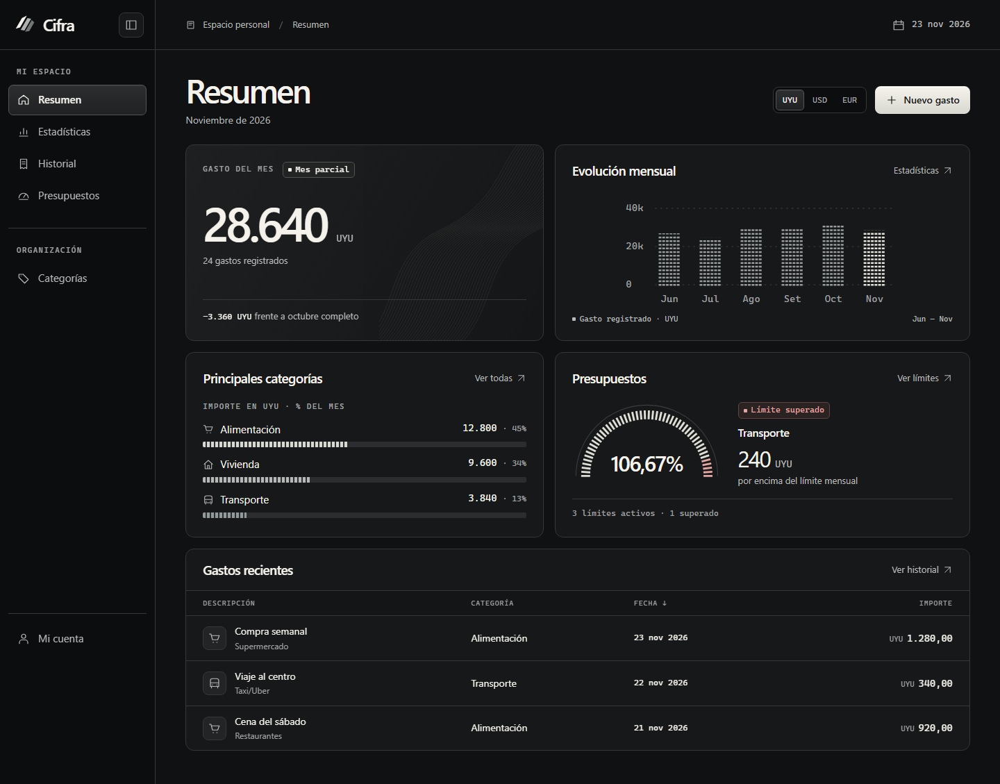

# UI-01 · Diseño visual de gastos personales

**Propuesta para aprobación visual · 23 de noviembre de 2026.** El gasto del mes, su distribución y el límite que requiere atención comparten la primera vista. Registrar un gasto está a un toque desde cualquiera de las cuatro pantallas de consulta.

## Galería

Cada PNG muestra la página completa. Las capturas de escritorio parten de una ventana de 1440 × 960 y las de móvil de 375 × 812. El contenido continúa al desplazarse hacia abajo.

| Pantalla | Escritorio | Móvil a 375 px | Qué revisar |
| --- | --- | --- | --- |
| Resumen | [Abrir captura](capturas/resumen-escritorio.png) | [Abrir captura](capturas/resumen-movil.png) | Total mensual, diferencia en UYU, seis meses, tres categorías principales, presupuesto con exceso y gastos recientes. |
| Estadísticas | [Abrir captura](capturas/estadisticas-escritorio.png) | [Abrir captura](capturas/estadisticas-movil.png) | Seis paneles, dos períodos comparables, favoritos, lectura tabular y línea anual con un año sin registros. |
| Historial | [Abrir captura](capturas/historial-escritorio.png) | [Abrir captura](capturas/historial-movil.png) | Encontrar una descripción y distinguir gastos en UYU y USD al recorrer la lista. |
| Presupuestos | [Abrir captura](capturas/presupuestos-escritorio.png) | [Abrir captura](capturas/presupuestos-movil.png) | Identificar la categoría excedida y leer cuánto queda en las demás. |
| Nuevo gasto | [Abrir captura](capturas/gasto-escritorio.png) | [Abrir captura](capturas/gasto-movil.png) | Borrador completo antes de guardar, con importe, moneda y acción principal visibles. |
| Login | [Abrir captura](capturas/login-escritorio.png) | [Abrir captura](capturas/login-movil.png) | Ingreso con Google para una cuenta autorizada. |

La misma pantalla de Resumen permite comparar la [barra lateral compacta](capturas/resumen-compacta.png), la [composición para tablet de 834 px](capturas/resumen-tablet.png) y el [menú móvil abierto](capturas/resumen-menu.png).

Una lámina adicional muestra el error de importe, la búsqueda vacía, la creación de una subcategoría, la confirmación de eliminación, el detalle anual y el reintento por conexión. [Componentes y estados](capturas/componentes-estados.png)

## Recorrer las láminas

Abrir el archivo HTML desde una copia local del repositorio. Los enlaces de navegación cambian de lámina y el botón junto a la marca alterna la barra lateral en escritorio. Para abrir directamente una vista, agregar al nombre del archivo `?vista=resumen`, `?vista=estadisticas`, `?vista=historial`, `?vista=presupuestos`, `?vista=gasto` o `?vista=login`. Las maquetas muestran ejemplos fijos y se pueden abrir sin instalación ni servicios externos. [Visor local](vistas/index.html)

## Decisiones para aprobación

- **Identidad.** Cifra es el nombre definitivo de la aplicación. El símbolo original de la marca y la ilustración de recibos acompañan la interfaz.
- **Cuotas.** El encargo menciona compras en cuotas. La exclusión expresa de la V1 determina los campos de la propuesta. Incorporarlas requeriría una decisión funcional posterior. [Alcance V1, §4](../../requisitos-v1.md#4-exclusiones-expresas-de-la-v1)
- **Tema.** La propuesta utiliza modo oscuro. Los requisitos vigentes contemplan un solo sistema de componentes y no piden un selector de tema.
- **Datos.** Los ejemplos son ficticios, con fecha de referencia del 23/11/2026 en Montevideo. En el Resumen, noviembre sigue abierto. Estadísticas muestra mayo–octubre para ilustrar una comparación entre períodos cerrados.

El análisis describe qué se toma de cada imagen. La especificación define medidas, componentes, estados y comportamiento de los flujos para el equipo que implemente la V1. [Referencias y sistema visual](sistema-visual.md) · [Especificación de pantallas y UX](pantallas.md)
