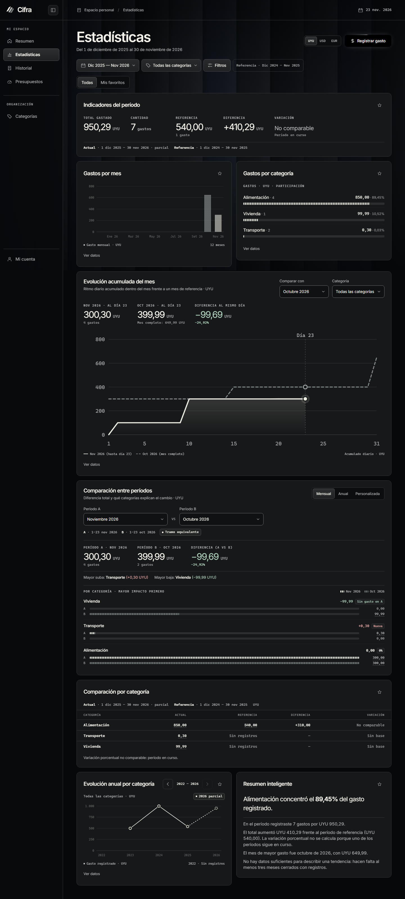

# IMP-04 · Estadísticas y evolución anual

**Estadísticas** (`/estadisticas`) presenta los seis paneles aprobados de RF-017 a RF-023 con datos agregados en PostgreSQL: indicadores del período, gastos por mes, gastos por categoría con desglose por subcategoría, comparación por categoría, evolución anual por categoría y resumen inteligente. Cada panel se calcula para **una sola moneda** (UYU, USD o EUR), elegida en el selector compartido y guardada por usuario. Las monedas nunca se suman ni se convierten.

## Funcionalidad

| Área | Comportamiento |
| --- | --- |
| Moneda (RF-021) | Selector UYU / USD / EUR junto al título. Llama a `set_currency` y, solo tras la confirmación, actualiza la caché de `get_preferences` de la sesión: se conserva al navegar y se restaura al volver a iniciar sesión. Los cambios se serializan (botones inactivos durante el envío). Ante un error se mantiene la moneda confirmada. Cambiar la moneda de consulta nunca modifica la moneda de un gasto. El componente `CurrencySelect` y `usePreferenceActions` quedan listos para Resumen y Presupuestos. |
| Respuestas tardías | Cada clave de TanStack Query incluye UUID, recurso y argumentos (moneda incluida) y no se usan datos de relleno de otra clave: al cambiar de moneda o de filtros se ocultan los importes anteriores y cada etiqueta de moneda sale de la respuesta (`filters.currency`), no del selector. Una prueba E2E retiene la respuesta UYU, cambia a EUR y la libera después: nunca se muestra. |
| Períodos | Mes actual, mes anterior, últimos 3/6/12 meses, año actual y rango personalizado, sobre la fecha civil de `America/Montevideo` que devuelve el servidor. La referencia predeterminada sigue ARCH-01 §9 (bloque anterior del mismo número de meses, año anterior o los N días previos) y se puede elegir libremente. El período en curso se rotula «parcial». |
| URL | `periodo`, `desde`/`hasta`, `ref-desde`/`ref-hasta`, `categoria`, `subcategoria`, `desglose`, `anual` y `vista=favoritos`. Los valores por defecto se omiten y los inválidos se descartan. La moneda no va en la URL: es una preferencia. |
| Indicadores (RF-017) | Total, cantidad, total de referencia con su cantidad, diferencia absoluta y variación. La variación solo aparece para períodos equivalentes con base; si no, «No comparable» con el motivo («Período en curso» o «Duraciones distintas») o «No disponible». Ambos totales abren el Historial de su intervalo. |
| Gastos por mes (RF-019) | Barras de celdas discretas (UI-01) con meses vacíos en su posición, tooltip por puntero, toque o teclado y tabla «Ver datos» (abierta por defecto en móvil). Tocar una barra abre su detalle con «Ver gastos». Rangos de más de 60 meses se recorren por bloques («Meses anteriores / siguientes»). |
| Categorías (RF-018) | Barras horizontales con importe, cantidad y participación. Tocar una categoría abre el desglose por subcategoría con «Sin subcategoría»; cada fila abre el Historial con esa clasificación. Las archivadas se rotulan. |
| Comparación | Tabla (tarjetas en móvil) con actual, referencia, diferencia y variación para la unión de categorías de ambos períodos. Un lado sin registros muestra «Sin registros» y la diferencia «—», sin variaciones ficticias. Cada importe abre su propio intervalo. |
| Evolución anual (RF-020) | Línea de cinco años terminada en el año actual (2022–2026), con selector propio «‹ ›» que navega por bloques del servidor y se guarda en `anual`. Es independiente del período general: cambiarlo no vuelve a consultar `get_annual`. Moneda y clasificación recalculan el mismo bloque. Años sin registros interrumpen la línea y se rotulan «Sin registros»; los puntos aislados conservan su marcador; el año actual se marca «parcial» y su tramo es punteado. La variación solo se calcula entre dos años cerrados consecutivos con registros. Cada punto con gastos abre el Historial del año civil. |
| Resumen inteligente (RF-023) | Plantillas deterministas (`summary.js`), sin IA: cantidad y total, categoría o subcategoría principal (con empates), comparación válida o motivo de su ausencia, mes de mayor gasto y tendencia solo con tres o más meses cerrados completos con registros que suben o bajan en cada paso. Sin registros muestra solo ese estado. |
| Favoritos | Estrella en cada panel (`aria-pressed`) persistida con `set_favorite`. «Mis favoritos» filtra los mismos paneles en orden canónico y conserva filtros, moneda y ventana anual. Sin favoritos: «Todavía no elegiste paneles» y «Ver todas». Solo se consultan las RPC de los paneles visibles. |
| Historial (RF-022) | Cada agregado abre `/historial` con los filtros exactos de la respuesta del servidor más `volver=<consulta de Estadísticas>`. El Historial conserva ese parámetro al filtrar, abrir la ficha o editar, y muestra «Volver a Estadísticas». Solo se aceptan rutas internas `/estadisticas…`. «Nuevo gasto» desde Estadísticas vuelve a la misma consulta. |

### Interacción y accesibilidad

- Puntero y toque muestran el tooltip. Soltar el puntero o el dedo sobre el propio elemento (columna completa del mes o círculo de 28 px alrededor del punto) lo selecciona. Se usa `pointerup` y no `click`: Recharts dibuja el punto resaltado encima entre `mousedown` y `mouseup`, y entonces el navegador no emite `click` sobre el punto. Un gesto de desplazamiento cancela el `pointerup`. La selección no depende del índice activo de Recharts, que se mueve al recibir foco, y el puntero no enfoca el SVG.
- Con teclado, la capa accesible de Recharts recorre meses o años con las flechas y Enter o Espacio abre el detalle. Escape lo cierra.
- Toda la información de cada gráfico está en su tabla HTML, con enlaces al Historial cuyo nombre accesible contiene el texto visible.

## Contrato y migración

[`20261125120000_reports.sql`](../../supabase/migrations/20261125120000_reports.sql) agrega:

| Objeto | Detalle |
| --- | --- |
| `app.favorites (owner_id, panel)` | PK compuesta, `CHECK` en las seis claves de ARCH-01 §10, RLS con lectura, alta y baja por propietario con plaza y sesión exacta. `authenticated` tiene `SELECT`, `DELETE` e `INSERT (owner_id, panel)`; sin `UPDATE`. |
| `api.get_preferences()` | Reemplazo con el mismo contrato; `favorites` ahora devuelve los paneles en orden canónico y `today` sale de `private.today()`. |
| `api.set_favorite(panel, enabled)` | Inserta o elimina; repetir es idempotente. 422 `INVALID_PANEL` / `INVALID_FAVORITE`. |
| `api.get_stats(filters, reference, month_offset)` | Respuesta de ARCH-01 §8 `{filters, reference, indicator, months, month_next_offset, categories, children, category_comparisons}` más `comparable` (booleano o NULL), que permite rotular «No comparable» sin recalcular en el cliente. Rango y moneda obligatorios; misma clasificación y moneda en ambos períodos. `STABLE`: todos los paneles se leen en una instantánea. |
| `api.get_annual(currency, end_year, category_id, subcategory_id)` | Respuesta de ARCH-01 §10. `end_year` fuera de `[1, año actual]` → 422 `INVALID_YEAR`. Admite clasificaciones archivadas. |
| Funciones auxiliares | `private.today()`, `private.panel_order`, `private.stats_filters`, `private.stats_reference`, `private.equivalent_periods` y `private.comparison_json`. Invocadoras, `search_path` vacío, `EXECUTE` solo para `authenticated`. |

### Reglas de cálculo

- **Una fila de gasto se cuenta una vez.** El predicado (dueño, una moneda, rango, categoría, hija o «sin hija») se aplica a `app.expenses` en un CTE materializado antes de unir nombres; las uniones con `categories` y `subcategories` son por clave primaria. Una categoría reúne sus gastos directos y los de todas sus hijas.
- **Exactitud.** `SUM(numeric)` y `COUNT(*)`; importes y porcentajes viajan como texto decimal. Los porcentajes se redondean una sola vez, a dos decimales, en SQL (mitad lejos de cero). El cliente solo cambia el formato con cadenas; `Number` se usa únicamente para la coordenada del gráfico.
- **Comparaciones.** `delta = A − B` solo si ambos lados tienen registros; `percent = 100 × (A − B) / B` solo si además los intervalos son equivalentes (igual número de días o de meses civiles completos, ambos concluidos). Un período vacío nunca produce −100 %.
- **Meses y años.** Calendario generado con `generate_series` y `LEFT JOIN`: un mes o año sin gastos conserva su lugar con `count = 0` y `total = NULL`. Los meses se recortan a los extremos del filtro y se devuelven en bloques de 60.
- **Rendimiento.** Los rangos acotados usan `expenses_currency_date_idx (owner_id, currency, spent_on)` bajo RLS; las políticas evalúan `private.allowed()` una vez por sentencia. No se agregaron índices.

### Estado en Supabase de desarrollo (`ljbrukrakumuatjnwxwd`)

**Aplicada el 23/11/2026** desde el editor SQL del panel, sin CLI ni conector de Supabase disponibles.

1. **Historial previo.** `supabase_migrations.schema_migrations` tenía exactamente `security`, `restrict_api_rpc_grants`, `catalog_and_expenses` y `expense_history`. No existían `app.favorites`, `api.get_stats` ni `private.today()`. 0 gastos, 1 plaza, PostgreSQL 17.12.
2. **Entorno desechable.** Antes, todas las migraciones se aplicaron desde cero en PostgreSQL embebido (`npm run test:db`, E2E y mediciones).
3. **Aplicación.** El texto del archivo más su registro (`20261125120000 reports`, `statements = [contenido del archivo]`, mismo formato que las versiones previas) se ejecutó como una sola transacción. Antes de ejecutar se comprobó en la página el SHA-256 del texto cargado en el editor (`9279b8e6…f9c4`) y el del archivo (`436384ed…8550`). El primer intento coincidió con un incidente de la Management API de Supabase («Unable to reach the server»); se verificó que no había aplicado nada (seguían 4 versiones y ningún objeto nuevo) y el segundo intento respondió «Success».
4. **Auditoría posterior.**
   - El historial tiene cinco versiones; el MD5 almacenado de `reports` (`5243260f…85a1`) coincide con el del archivo.
   - Las diez funciones nuevas o reemplazadas son invocadoras, con `search_path` vacío, propietario `postgres` y `EXECUTE` solo para `authenticated` (no `anon` ni `service_role`).
   - `api` tiene 13 RPC; ninguno es ejecutable por `anon` ni `SECURITY DEFINER`. `anon` no tiene uso de `api` ni de `app`.
   - `app.favorites`: RLS activa, políticas `read_own`, `insert_own` y `delete_own`, sin `UPDATE`, 0 filas.
   - Ejecutadas como `authenticated` con la sesión vigente de la plaza, sin escribir datos: `get_preferences` devuelve `favorites: []` y `today: 2026-11-23`; `get_stats` y `get_annual` devuelven la estructura esperada (ventana 2022–2026, 2026 parcial, sin registros).
   - No se tocaron Auth, usuarios ni datos: siguen 0 gastos.
5. **HTTP con la clave publicable.** Pasan las 6 pruebas públicas de IMP-01 a IMP-04: `get_stats`, `get_annual` y `set_favorite` responden `42501` sin sesión y `app.favorites` no está expuesta. Antes de aplicar, `get_stats` respondía 404.

## Pruebas ejecutadas

| Prueba | Resultado y alcance |
| --- | --- |
| Unitarias · `npm test` | **82 aprobadas, 13 nuevas.** Preajustes y referencias con cambio de año, bisiestos y año 1; URL de ida y vuelta y descarte de valores inválidos; independencia de la ventana anual; argumentos exactos de las RPC; formato de importes, signos y porcentajes sin `Number`; traducción de cada agregado a los filtros de `list_expenses`; validación de `volver` contra rutas externas; plantillas del resumen con empates, falta de base, tendencia sostenida, hueco y período vacío. |
| SQL · `npm run test:db` | **41 aprobadas, 16 nuevas**, sobre todas las migraciones en PostgreSQL embebido con la fecha congelada en 23/11/2026. Ver el informe de exactitud. La auditoría de superficie de IMP-02 se amplió con las RPC y funciones nuevas. |
| Rendimiento SQL | 36.500 gastos de una persona en diez años (ARCH-01 §2): cada respuesta coincide con el modelo independiente y el período acotado usa el índice bajo RLS. Ver mediciones. |
| Chromium · `npm run test:e2e` | **41 aprobadas, 11 nuevas**, y las 30 previas sin cambios. Valores exactos de los seis paneles, desglose, comparación y resumen; selector de moneda con respuesta tardía descartada, persistencia al navegar y tras cerrar e iniciar sesión; ventana anual con navegación de bloques, cambio de período, moneda y categoría, teclado y coincidencia con el Historial; cada agregado contrastado con la suma de las filas del Historial; edición desde el Historial reflejada al volver; eliminación del único gasto de un año; favoritos persistentes; capturas y ausencia de desbordamiento horizontal a 1440, 834 y 375 px; toque en barras y puntos con `hasTouch`; presionar, esperar y soltar sobre una barra o un punto. El transporte simula Auth y la Data API y ejecuta las RPC contra PostgreSQL embebido. |
| HTTP contra desarrollo | **6 aprobadas** (las públicas de IMP-01 a IMP-04, una nueva). 8 omitidas porque requieren JWT de sesiones de prueba, entre ellas la autenticada nueva de IMP-04. |
| Calidad | ESLint y build de Vite aprobados. |

Para la suite web: `CIFRA_CHROMIUM_PATH` apunta a un Chromium local si falta el de Playwright, y `CIFRA_E2E_PORT` permite otro puerto si 4173 está ocupado. Para las pruebas HTTP de IMP-01 definí además `CIFRA_TEST_SUPABASE_URL` y `CIFRA_TEST_SUPABASE_PUBLISHABLE_KEY`.

## Informe de exactitud financiera

Las pruebas no comparan PostgreSQL consigo mismo. [`oracle.js`](../../supabase/tests/database/oracle.js) recalcula cada panel desde las filas sintéticas con centésimos `BigInt`, sin SQL, y cada respuesta de `get_stats` y `get_annual` se compara completa contra ese modelo. Además, los casos clave se escribieron con resultados calculados a mano:

| Caso | Resultado verificado |
| --- | --- |
| RF-017 · UYU 100 + UYU 200 + USD 300 | UYU: 300,00 y 2 gastos. USD: 300,00 y 1 gasto. EUR: sin registros. Ninguna respuesta contiene 600,00. |
| Céntimos | 0,10 + 0,20 = 0,30 exactos. Noviembre en UYU: 100 + 200 + 0,10 + 0,20 + 50 = 350,30. |
| RF-018 · hijas sin duplicación | Restaurantes 200 + Supermercado 100 + sin hija 50 = Alimentación 350,00, con 57,14 % + 28,57 % + 14,29 % = 100 %. La suma de hijas y de cantidades coincide con el padre. |
| Participación | 350 / 350,30 = 99,91 %; 0,30 / 350,30 = 0,09 %. Sobre 2.104,62: 47,56 %, 44,35 %, 8,08 % y 0,01 %. |
| Redondeo único | +0,005 % → 0,01 %; −0,005 % → −0,01 %; 4/3 → 33,33 %; 3/4 → −25 %. |
| Comparaciones | Octubre vs agosto cerrados: −350,99 y −35,06 %. Mes en curso: diferencia sin porcentaje. Referencia sin registros o período vacío: diferencia y porcentaje NULL (nunca −100 %). Categorías presentes en un solo lado. Nueve reglas de equivalencia, incluidos meses de 30 y 31 días, años de 365 y 366 días y trimestres. |
| Meses | Doce posiciones con los meses vacíos como `count 0 / total NULL`; 120 meses en dos bloques de 60 cuya suma coincide con el total; extremos 0001-01 y 9999-12. |
| Evolución anual | Alimentación UYU 2022–2026: Sin registros, 500,00, 600,00 (+100,00 / +20 %), 540,00 (−60,00 / −10 %), 933,33 parcial. Bloque 2017–2021 con 2017 comparado contra 2016 fuera del bloque (+22,22 / +200 %) y vuelta al bloque inicial. Todas las categorías, USD, subcategoría con puntos aislados y categoría e hija archivadas. |
| Ediciones | Noviembre 300 → 200 baja el total 100 exactos; mover de mes, de moneda y de categoría resta en un grupo y suma en el otro; eliminar el único gasto de 2024 deja «Sin registros» y quita la variación de 2025. |
| Estadísticas = Historial | En SQL, para las tres monedas: total, cada mes, cada categoría, cada hija y «sin hija», y cada punto anual en cuatro clasificaciones y dos bloques coinciden en cantidad y suma exacta con todas las páginas de `list_expenses`. En Chromium se suman las filas que muestra el Historial al abrir el total, un mes, una subcategoría, una comparación y un año. |
| Volumen | 36.500 gastos con importes, monedas y clasificaciones pseudoaleatorias: ocho consultas (mes, 12 meses con referencia, dos bloques de diez años, desglose y tres series anuales) coinciden exactamente con el modelo. |
| Seguridad | B no ve datos de A ni puede usar sus IDs (404); identidad sin plaza, sesión ajena, cerrada o ausente → 403; `anon` sin ejecución; favoritos ajenos invisibles y no modificables por SQL directo. |

## Mediciones de rendimiento

| Medición | Resultado |
| --- | --- |
| SQL, PostgreSQL embebido (WASM, un hilo), 36.500 gastos, mediana de 5 | `get_stats`: mes 3,6 ms; 12 meses con referencia 5,5 ms; diez años 23,5–23,9 ms por bloque; desglose 5,1 ms. `get_annual`: 7,8–10,5 ms. Respuestas de 0,7 a 7,2 KB. Un mes con RLS: `Index Scan using expenses_currency_date_idx`, 156 buffers, 2,6 ms. |
| Bundle (gzip) | Inicial 132,6 KB (128,8 antes de IMP-04). Estadísticas 9,5 KB y Recharts 123,3 KB en chunks diferidos; el de gráficos empieza a descargarse en paralelo con la primera consulta. CSS 7,1 KB. |
| Chromium a 375 px con CPU 4× y 3.650 gastos, tres corridas | Desde la recarga completa: indicadores 1,25–1,57 s y gráficos 1,58–1,92 s. Cambio de moneda 0,30–0,64 s. Cambio de período 0,41–0,73 s, sin volver a pedir `get_annual`. Data API local: no incluye red. |

## Decisiones

- **Recharts** (propuesto en ARCH-01) solo para las barras mensuales y la línea anual, en carga diferida. Gastos por categoría usa barras HTML con la trama de UI-01: cada fila es un botón o enlace nativo, accesible sin capa adicional.
- **Retícula sólida y tenue.** UI-01 pide una retícula de poco contraste; se usa una línea sólida de 1 px en lugar de la punteada de la maqueta para no confundirla con una proyección.
- **Eje Y desde cero** en la línea anual, para no exagerar variaciones entre años.
- **`comparable` en `get_stats`.** Extensión compatible del contrato para que «No comparable» se decida en el servidor con la misma fecha civil que los demás cálculos.
- **`private.today()`** centraliza la fecha civil de Montevideo; las pruebas la congelan (ARCH-01 §14).
- **«Resumen inteligente»** como título del panel, el nombre de RF-023 (UI-01 lo rotulaba «Resumen del período»).

## Capturas de Chromium

| Vista | Escritorio · 1440 px | Tablet · 834 px | Móvil · 375 px |
| --- | --- | --- | --- |
| Seis paneles, últimos 12 meses | [Escritorio](capturas/estadisticas-1440.png) | [Tablet](capturas/estadisticas-834.png) | [Móvil](capturas/estadisticas-375.png) |
| Detalle de un punto anual | [Escritorio](capturas/anual-detalle-1440.png) | [Tablet](capturas/anual-detalle-834.png) | [Móvil](capturas/anual-detalle-375.png) |
| Desglose por subcategoría | [Escritorio](capturas/desglose-1440.png) | [Tablet](capturas/desglose-834.png) | [Móvil](capturas/desglose-375.png) |
| Historial abierto desde un agregado | [Escritorio](capturas/historial-desde-estadisticas-1440.png) | [Tablet](capturas/historial-desde-estadisticas-834.png) | [Móvil](capturas/historial-desde-estadisticas-375.png) |

## Recorrido real con Google y la Data API alojada

Se ejecutó el 24/11/2026 con la rama en `http://localhost:5173` (servidor de desarrollo propio, tras detener con autorización del titular los procesos de una sesión anterior que ocupaban los puertos 5173 y 4173) contra `cifra-development`. La sesión Google de la primera plaza seguía vigente en el navegador integrado; los tokens no se leyeron ni se copiaron. Se usaron cuatro gastos rotulados «(borrar) IMP-04», que se eliminaron al final.

| Paso | Resultado |
| --- | --- |
| Estado inicial | UYU, sin favoritos, sin gastos, fecha civil 24/11/2026. Paneles vacíos con «Sin registros» y «No disponible». |
| Alta desde el formulario | a) UYU 123,45 · 20/11/2026 · Alimentación / Supermercado. b) UYU 76,55 · 15/10/2026 · Transporte. c) USD 10,00 · 21/11/2026 · Alimentación. d) UYU 150,00 · 01/06/2025 · Alimentación. |
| Mes actual en UYU | Total 123,45 y 1 gasto; referencia octubre 76,55; diferencia +46,90; «No comparable · Período en curso». Alimentación 100 %. Resumen: «Todo el gasto registrado corresponde a Alimentación… El total aumentó UYU 46,90…». |
| Evolución anual | 2022–2024 «Sin registros»; 2025 = 150,00 «Sin base»; 2026 parcial = 123,45 + 76,55 = 200,00; dos puntos, 2025 aislado. |
| Año actual frente a 2025 | Alimentación 123,45 frente a 150,00 = −26,55 sin porcentaje; resumen «61,73 %» (123,45 / 200 = 61,725 → 61,73) y «aumentó UYU 50,00». |
| Moneda | USD: 10,00 y 1 gasto, ningún panel con UYU. Se conservó al navegar y al recargar la página (viene de `get_preferences` alojado). Se volvió a UYU. |
| Favoritos | «Evolución anual» marcada: «Mis favoritos · 1» con solo ese panel tras recargar, con el período en la URL. Se desmarcó al final. |
| Ventana anual | 2017–2021 se conservó al cambiar el período general a «Año actual» (subtítulo de 2026), con «Sin registros en UYU entre 2017 y 2021». |
| Historial | El total de 2026 abrió `/historial?desde=2026-01-01&hasta=2026-12-31&moneda=UYU&volver=…` con los dos gastos UYU: 123,45 + 76,55 = 200,00, igual que el indicador. «Volver a Estadísticas» restauró `periodo=anio`. |
| Borrado | Al borrar los gastos de 2026, el año quedó «Sin registros» con referencia 150,00 y diferencia y variación «No disponible», sin −100 %. Tras borrar el último gasto, el Historial muestra «Todavía no registraste gastos» y la línea anual, «Sin registros en UYU entre 2022 y 2026». |
| Estado final | UYU, sin favoritos y sin gastos, como al empezar. |

Defectos encontrados y corregidos durante el recorrido:

- **Primer clic sobre un punto perdido.** Al llegar con el puntero y presionar enseguida, Recharts dibujaba el punto resaltado encima antes de soltar; el registro de eventos mostró `pointerdown` y `pointerup` sobre el punto y ningún `click`. La selección pasó a `pointerup` y el primer clic sobre el punto 2025 y sobre la barra de noviembre abrió su detalle. Playwright deja pasar un cuadro entre mover y presionar, así que su prueba no reproduce esa carrera; la comprobación es manual.
- **Rótulo de Comparación.** Una categoría con referencia pero sin gastos actuales decía «Sin base»; ahora dice «No disponible» y «Sin base» queda para la referencia vacía.

## Pendientes

- **Prueba HTTP autenticada por script.** Con `CIFRA_TEST_ACCESS_TOKEN_A` se ejecuta la de IMP-04; no se copió ningún JWT. La segunda plaza sigue sin habilitar, así que el aislamiento entre las dos plazas reales se verificó solo en PostgreSQL embebido.
- **Planes y latencia con volumen representativo en el proyecto alojado.** La tabla alojada está vacía y no se insertaron gastos sintéticos; el volumen se midió en PostgreSQL embebido.
- **Teléfono físico.** Toque, foco y fluidez se comprobaron en Chromium con viewport de 375 px, `hasTouch` y CPU ralentizada.
- **Resumen y Presupuestos** (IMP-05) deben reutilizar `CurrencySelect`, `usePreferenceActions` y `get_stats` para el mes actual.
