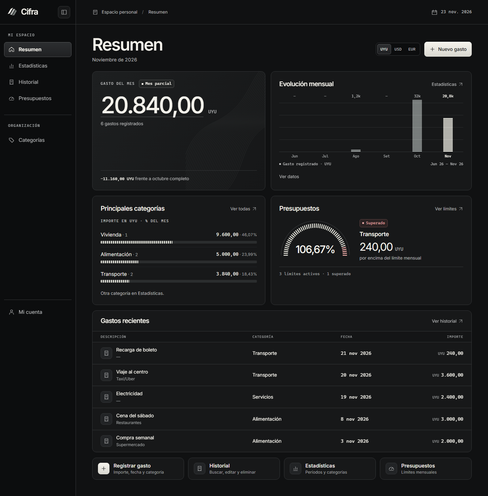

# IMP-05 · Presupuestos mensuales y Resumen

**Presupuestos** (`/presupuestos`) gestiona límites mensuales por categoría y moneda (RF-024 a RF-026). **Resumen** (`/`) es la pantalla inicial (RF-027): gasto del mes, seis meses, principales categorías, estado de los presupuestos y gastos recientes de la moneda elegida. Ambas leen datos reales de Supabase, comparten con Estadísticas la moneda guardada por usuario (RF-021) y reutilizan `get_stats` y `list_expenses` sin un segundo motor de cálculo.

## Funcionalidad

| Área | Comportamiento |
| --- | --- |
| Crear límite (RF-024) | «Crear límite» abre categoría, moneda y límite mensual. Se propone la moneda activa. Solo se ofrecen categorías activas de primer nivel: las subcategorías no admiten límites y una categoría archivada no admite límites nuevos. El límite acepta coma o punto, hasta 12 enteros y 2 decimales, mayor que cero; sin separadores de miles. |
| Duplicados | Al elegir categoría y moneda, el formulario consulta los límites de esa moneda (misma caché que la lista) y, si la combinación existe, lo indica con el límite vigente y ofrece «Editar ese límite». El servidor responde 409 `DUPLICATE_BUDGET` ante una carrera; si un envío previo cuya respuesta se perdió ya lo creó con el mismo importe, se toma como confirmado. |
| Seguimiento (RF-025) | Consumo = suma de los gastos de la categoría (directos y de todas sus subcategorías, una vez cada uno) en la moneda del límite durante el mes civil actual de `America/Montevideo`. Restante = límite − consumo (negativo si se superó). Porcentaje = 100 × consumo / límite, redondeado una vez a dos decimales en SQL. Sin gastos: 0,00. Al cambiar de mes el mismo límite vuelve a contar desde cero; no hay sobrantes ni arrastres. |
| Estados (UI-01) | Menos de 90 %: «Dentro del límite». Desde 90 % y menos de 100 %: «Cerca del límite» (ámbar). Exactamente 100 %: «Límite alcanzado». Más de 100 %: «Superado» (rosa) con el exceso. El estado se decide comparando centésimos exactos, no el porcentaje redondeado: 3.600,01 de 3.600 se muestra «100%» y «Superado» con exceso 0,01. La barra se satura al 100 %; el texto conserva el porcentaje real (106,67 %). |
| Orden | Mayor porcentaje utilizado primero, desempate por nombre (en SQL). El primero se destaca con el arco de UI-01. |
| Editar y retirar (RF-026) | Menú «⋯» de cada límite: «Editar límite» (muestra categoría, moneda y consumo del mes) y «Retirar límite» (confirma categoría y moneda y explica que los gastos y las estadísticas se conservan; el foco inicial queda en «Cancelar»). Ninguna operación modifica gastos. Un límite bajo una categoría archivada sigue visible («Archivada»), editable y retirable. Retirar un límite ya retirado (por ejemplo, tras una respuesta perdida) se considera hecho. |
| Resumen (RF-027) | Mes y moneda en la cabecera. **Gasto del mes**: total (enlace al Historial del mes y la moneda), cantidad, «Mes parcial» y comparación con el mes anterior completo (diferencia con signo; «Sin base de comparación» si ese mes no tiene gastos en la moneda). **Evolución mensual**: el mes actual y los cinco anteriores, con los meses vacíos en su lugar y la tabla «Ver datos». **Principales categorías**: las tres de mayor importe con su participación sobre el total real del mes. **Presupuestos**: el límite de mayor uso con su arco y «N límites activos · M superados», o «Crear presupuesto». **Gastos recientes**: cinco del mes y la moneda. **Accesos rápidos**: Registrar gasto, Historial, Estadísticas y Presupuestos. |
| Estados vacíos y error | Sin gastos el Resumen ofrece «Registrar un gasto» y, tras guardarlo, vuelve al Resumen ya actualizado. Sin límites ofrece «Crear presupuesto», que abre el formulario en Presupuestos. Cada bloque tiene su propia carga y su propio error con «Reintentar»: un fallo de `get_budgets` no oculta el total del mes. |
| Moneda (RF-021) | `CurrencySelect` y `usePreferenceActions` de IMP-04 en las tres pantallas; la preferencia se guarda por usuario y se conserva al navegar y al volver a iniciar sesión. Las claves de TanStack Query incluyen UUID, recurso y moneda, sin datos de relleno de otra clave: una respuesta UYU tardía nunca se muestra bajo USD y cada etiqueta de moneda sale de la respuesta. |

### Accesibilidad e interacción

- Tabla desde 1181 px y tarjetas por debajo (UI-01). Se monta solo una de las dos vistas: cada límite tiene un único menú en el documento.
- El menú de cada límite se abre con Enter o toque, enfoca su primera acción y se cierra con Escape devolviendo el foco. Al cerrar un diálogo el foco vuelve al botón del menú.
- El arco tiene nombre accesible («106,67% utilizado»); las barras mensuales del Resumen, uno con todos los valores exactos, y la tabla «Ver datos» enlaza cada mes con gastos al Historial.
- El Resumen no usa Recharts: seis barras de celdas discretas en HTML/CSS, para no descargar el chunk de gráficos (123 KB gzip) en la pantalla principal.

## Contrato y migración

[`20261126120000_budgets.sql`](../../supabase/migrations/20261126120000_budgets.sql) agrega, conforme a ARCH-01 §5, §7 y §8:

| Objeto | Detalle |
| --- | --- |
| `app.budgets (owner_id, category_id, currency, monthly_limit)` | PK `(owner_id, category_id, currency)`: un límite por combinación. FK `(owner_id, category_id) → app.categories` RESTRICT, que solo admite categorías de primer nivel. `CHECK` de moneda UYU/USD/EUR y `numeric(14,2)` entre 0,01 y 999.999.999.999,99. RLS con `read_own`, `insert_own`, `update_own` y `delete_own` (dueño + `private.allowed()`, plaza y sesión exacta). `authenticated`: `SELECT`, `DELETE`, `INSERT (owner_id, category_id, currency, monthly_limit)` y `UPDATE (monthly_limit)` únicamente. |
| `api.get_budgets(currency)` | `{month, currency, items:[Budget]}`; `month` = `YYYY-MM` del mes civil del servidor (`private.today()`). |
| `api.create_budget(category_id, currency, monthly_limit)` | Budget del mes actual, con el consumo ya registrado. Bloquea la categoría `FOR SHARE` (padre activo, ARCH-01 §6). 409 `DUPLICATE_BUDGET`, 404 `CATEGORY_NOT_FOUND`, 422 `CATEGORY_ARCHIVED`. |
| `api.update_budget(category_id, currency, monthly_limit)` | Cambia solo el límite. 404 `BUDGET_NOT_FOUND`. Admite categorías archivadas. |
| `api.delete_budget(category_id, currency)` | `{deleted: true}`. 404 `BUDGET_NOT_FOUND`. Ninguna mutación sobre gastos. |
| Budget | `{category_id, category_name, currency, monthly_limit, spent, remaining, percent}` como texto decimal con dos decimales; `remaining` puede ser negativo. |
| Funciones auxiliares | `private.budget_limit` (valida el texto **antes** de convertir a `numeric`, sin redondeos), `private.budget_currency` y `private.budget_items` (preagrupa los gastos del mes por categoría y moneda y une desde cada límite con `LEFT JOIN`). Invocadoras, `search_path` vacío, `EXECUTE` solo para `authenticated`. |

Errores: 422 `INVALID_MONTHLY_LIMIT` (cero, negativo, exponente, NaN, tres decimales, más de doce enteros, espacios, coma) e `INVALID_CURRENCY`. Se usó `INVALID_MONTHLY_LIMIT` y no `INVALID_LIMIT` porque este último ya significa «tamaño de página inválido» en `list_expenses`. Todos los RPC comprueban plaza y sesión exacta (403) antes de validar argumentos. Identificadores ajenos responden igual que los inexistentes (404).

**Mismo predicado que Estadísticas.** `budget_items` filtra dueño, una moneda, `spent_on` entre el primer y el último día del mes y la categoría padre, igual que `get_stats`. El Resumen pide `get_stats` con exactamente los argumentos de la vista por defecto de Estadísticas (mes actual con referencia al mes anterior) y de «Últimos 6 meses»: comparten clave de caché y respuesta, por lo que no pueden discrepar. No se detectaron inconsistencias en IMP-04 ni se modificó su motor.

### Cambios mínimos fuera de IMP-05

- `PanelBody` acepta un texto de carga; `CategoryRow` y `HistoryLink` se exportan para reutilizarlos en el Resumen. `PANELS`, cálculos y contratos de IMP-04 no cambian.
- `finance.js` traduce los tres códigos nuevos y agrega `useRecentExpenses` (una página de `list_expenses` bajo el prefijo `[uuid, 'expenses']`, invalidada por toda mutación de gastos).
- Pruebas previas ajustadas: la auditoría de superficie lista los 17 RPC y las tres funciones nuevas; el doble de Supabase de las pruebas de acceso responde las lecturas del Resumen vacío; dos pruebas del Historial suponían que entrar no hacía llamadas y ahora distinguen las lecturas del Resumen (siguen exigiendo cero escrituras y cursores encadenados).

### Invalidación (ARCH-01 §12)

- Crear, editar o retirar un límite invalida `[uuid, 'budgets']` en todas las monedas: Presupuestos y Resumen se actualizan.
- Registrar, editar o eliminar un gasto ya invalidaba todas las claves del usuario (IMP-02/03): al volver, Resumen y Presupuestos releen.
- Mutar el catálogo (renombrar o archivar) también invalida los presupuestos, que traen el nombre vigente.

### Estado en Supabase de desarrollo (`ljbrukrakumuatjnwxwd`)

**Aplicada el 24/11/2026** desde el editor SQL del panel (navegador integrado con la sesión existente del titular; la CLI no tiene token de acceso).

1. **Historial previo.** `supabase_migrations.schema_migrations` tenía `security`, `restrict_api_rpc_grants`, `catalog_and_expenses`, `expense_history` y `reports` (MD5 de `reports` = archivo). No existía `app.budgets`; 13 RPC en `api`; 0 gastos.
2. **Entorno desechable.** Antes se ejecutó el script exacto (archivo + registro) sobre las migraciones previas en PostgreSQL embebido: 17 RPC y MD5 registrado igual al del archivo. Todas las suites corrieron también desde cero.
3. **Aplicación.** Archivo con su registro (`20261126120000 budgets`, `statements = [contenido del archivo]`, mismo formato que las versiones previas) insertado antes del `commit;`, como una sola transacción. SHA-256 del texto cargado en el editor (`748c6dfd…9c1b`, 16.709 caracteres) igual al del script local. El panel advirtió «operaciones destructivas» por los `revoke` sobre los objetos nuevos y el `delete` del cuerpo de `delete_budget`; respuesta «Success».
4. **Auditoría posterior.**
   - Seis versiones; MD5 de `budgets` (`fa0ad5bb…1999`) = archivo.
   - `app.budgets`: RLS activa, cuatro políticas, `UPDATE` solo en `monthly_limit`, 0 filas.
   - Las siete funciones nuevas: propietario `postgres`, invocadoras, `search_path` vacío, `EXECUTE` para `authenticated` y no para `anon` ni `service_role`. `api` tiene 17 RPC; ninguno `SECURITY DEFINER` ni ejecutable por `anon`.
   - Como `authenticated` con la sesión vigente de la plaza, en un bloque revertido por una excepción final: lista vacía → crear Alimentación UYU 15.000 → editar a 18.000 → duplicado 409 → límite 0 422 → retirar → lista vacía. Después: 0 límites, 0 gastos.
5. **HTTP con la clave publicable.** 7 pruebas públicas aprobadas (IMP-01 a IMP-05, una nueva): los cuatro RPC de presupuestos responden `42501` sin sesión y `app.budgets` no está expuesta.
6. **Recorrido real con Google** (`http://localhost:5173`, sesión vigente de la primera plaza, sin leer tokens). Gastos rotulados «(borrar) IMP-05»: UYU 2.000 Supermercado, UYU 3.000 Restaurantes y USD 50 Alimentación. Límite Alimentación UYU 15.000 desde el formulario: **5.000,00 de 15.000,00, restan 10.000,00, 33,33 %**; USD 50 fuera. Resumen 5.000,00 = Estadísticas 5.000,00 = consumo del límite. USD: 50,00 y «Todavía no tenés límites mensuales en USD», sin cifras UYU. Editar a 18.000: 27,78 %, restan 13.000. Retirar: los tres gastos siguen en el Historial. Se eliminaron los gastos y se volvió a UYU: Resumen sin registros, como al empezar. Consola sin errores.

## Pruebas ejecutadas

| Prueba | Resultado y alcance |
| --- | --- |
| Unitarias · `npm test` | **88 aprobadas, 6 nuevas.** Umbrales de estado en centésimos (89,99 / 90 / 99,999 / 100 / 100,0003 %), restante y exceso desde `remaining`, barra saturada, conteos, mes, límite tecleado (sin separadores de miles) y argumentos del Resumen idénticos a los de Estadísticas, con cambio de año y febrero bisiesto. |
| SQL · `npm run test:db` | **55 aprobadas, 14 nuevas**, sobre todas las migraciones en PostgreSQL embebido con la fecha congelada en 23/11/2026. Ver el informe de exactitud. |
| Chromium · `npm run test:e2e` | **60 aprobadas, 19 nuevas** (más las 41 previas). Presupuestos: alta con gastos previos, validación, duplicado y edición, retiro con gastos intactos, estados y orden, barra saturada, moneda compartida con respuesta tardía descartada, consumo que sigue a altas, ediciones (importe, fecha, categoría, moneda) y eliminaciones, categoría archivada con teclado, toque en móvil y capturas. Resumen: valores exactos de los cinco bloques, coincidencia con Estadísticas, Presupuestos e Historial, cambio de moneda con respuestas retenidas, cuenta vacía con primer gasto y primer límite, error aislado de un bloque, capturas, toque y mediciones. |
| HTTP contra desarrollo | **7 aprobadas** (públicas de IMP-01 a IMP-05). 9 omitidas porque requieren JWT de sesiones de prueba, entre ellas la autenticada nueva de IMP-05 (`CIFRA_TEST_ACCESS_TOKEN_A`). |
| Calidad | ESLint y build de Vite aprobados. |

## Informe de exactitud

[`oracle.js`](../../supabase/tests/database/oracle.js) incorpora `expectedBudgets`, que recalcula cada presupuesto desde las filas de gasto con centésimos `BigInt`, sin SQL. Cada respuesta de `get_budgets` de la suite se compara completa contra ese modelo; además, los casos clave se escribieron a mano:

| Caso | Resultado verificado |
| --- | --- |
| Ejemplo obligatorio | Supermercado 2.000 + Restaurantes 3.000 UYU registrados **antes** del límite; Alimentación USD 50. Límite 15.000 UYU → consumo 5.000,00, restante 10.000,00, 33,33 %. USD 50 no interviene; el límite USD 200 de la misma categoría consume 50,00 (25 %). |
| Sin subcategoría | + 250,50 UYU sin hija → 5.250,50 (35,00 %), contado una vez. |
| Sin gastos | Salud 2.500 → 0,00 consumido, 2.500,00 restante, 0,00 %. |
| Editar límite | 15.000 → 18.000 sobre 5.250,50 → 29,17 %, restan 12.749,50; los gastos (importe, versión, `updated_at`) idénticos. |
| 100 % exacto | Transporte 3.600 de 3.600 → 100,00 %, restante 0,00, «Límite alcanzado». |
| Superado | + 240 → 3.840 de 3.600 = 106,67 %, restante −240,00; con un céntimo de exceso, 100,00 % y −0,01. |
| Orden | Transporte 106,67 · Vivienda 96 · Alimentación 29,17 · Salud 0 · Servicios 0 (empate por nombre). |
| Ediciones | Alta de 1.000 → 6.250,50; importe a 400 → 5.650,50; fecha a octubre → 5.250,50; categoría a Vivienda → Vivienda 10.000,00 (100 %); moneda a USD → sale del contador UYU; eliminar → resta exactamente su importe. |
| Cambio de mes | 31/10 y 01/12 fuera de noviembre. Con la fecha en 01/12/2026: Alimentación 1.500 de 18.000 = 8,33 % y los demás en 0; en enero de 2027 todos en 0 con el límite completo como restante. |
| Coherencia | Para UYU, USD y EUR, cada `spent` = total de la categoría en `get_stats` del mismo mes = suma de todas las páginas de `list_expenses` con ese filtro. |
| Categoría archivada | Alta nueva → 422; el existente sigue listado, se edita (9.600 / 12.000 = 80 %) y se retira; al restaurar admite altas otra vez. |
| Retirar | Solo el límite: gastos, `get_stats` del año y `get_annual` idénticos; segundo retiro → 404; recrearlo muestra el consumo vigente (3.840 / 4.000 = 96 %). |
| Validación | `0`, `0.00`, `0.001`, `-1`, `1e3`, `abc`, `1.234`, vacío, espacios, coma, 13 dígitos, `NaN` y NULL → 422; extremos 0,01 y 999.999.999.999,99 aceptados. Subcategoría como categoría → 404. |
| Aislamiento | B no ve ni modifica límites de A (404 con sus IDs; SQL directo sin filas; insert con dueño ajeno rechazado por RLS); un límite de B no altera los de A. Sin plaza, sesión ajena, cerrada o ausente → 403 antes de validar; `anon` → 42501. |
| Resumen | 20.840,00 UYU en 6 gastos; Vivienda 46,07 %, Alimentación 23,99 %, Transporte 18,43 % sobre el total real (suman 88,49 %); octubre 32.000 → −11.160,00; seis meses junio–noviembre con 1.234,56, 32.000,00 y 20.840,00 y tres meses «Sin registros»; mayo y un gasto futuro de diciembre fuera; «Últimos 6 meses» en Estadísticas 54.074,56. Editar la cena 3.000 → 2.000 baja el Resumen a 19.840,00 y Alimentación a 4.000,00 (20,16 %) en Resumen y Presupuestos. |

## Rendimiento

| Medición | Resultado |
| --- | --- |
| SQL, PostgreSQL embebido (WASM, un hilo), 36.500 gastos | `get_budgets` con 13 límites UYU: mediana 2,0 ms, 2,5 KB, igual al modelo independiente. La agregación del mes usa `Index Scan using expenses_currency_date_idx` bajo RLS (151 filas leídas). |
| Lecturas del Resumen | Cuatro RPC en paralelo y sin consultas secuenciales: `get_stats` del mes, `get_stats` de seis meses, `get_budgets` y una página de cinco gastos de `list_expenses`. Ir a Estadísticas desde «Ver todas» no repite `get_stats` (misma clave en caché). |
| Bundle (gzip) | Inicial 144,3 KB (132,6 KB en IMP-04): Resumen, Presupuestos y los componentes de Estadísticas que ahora reutiliza el Resumen pasan al chunk inicial; el chunk de Estadísticas baja de 9,5 a 4,7 KB. El Resumen no descarga Recharts (123,3 KB). CSS 8,6 KB. Sin dependencias nuevas. |
| Chromium, 3.650 gastos y 10 límites, tres corridas | Escritorio (1440 px): total visible 83–97 ms y Resumen completo 106–118 ms desde la navegación; cambio de moneda 134–154 ms. Móvil (375 px, CPU 4×): 400–488 ms y 416–509 ms; cambio de moneda 162–200 ms. Dentro de la corrida completa de las 60 pruebas, con la máquina más cargada: escritorio 242 ms y móvil 1.418 ms hasta el Resumen completo (en esa misma corrida, la medición de Estadísticas de IMP-04 dio 1.933 ms para indicadores, frente a 1,25–1,57 s en su informe). Data API local: no incluye red. |

## Capturas de Chromium

| Vista | Escritorio · 1440 px | Tablet · 834 px | Móvil · 375 px |
| --- | --- | --- | --- |
| Resumen | [Escritorio](capturas/resumen-1440.png) | [Tablet](capturas/resumen-834.png) | [Móvil](capturas/resumen-375.png) |
| Presupuestos | [Escritorio](capturas/presupuestos-1440.png) | [Tablet](capturas/presupuestos-834.png) | [Móvil](capturas/presupuestos-375.png) |
| Combinación duplicada | [Escritorio](capturas/presupuesto-duplicado-1440.png) | [Tablet](capturas/presupuesto-duplicado-834.png) | [Móvil](capturas/presupuesto-duplicado-375.png) |
| Retirar límite | [Escritorio](capturas/presupuesto-retirar-1440.png) | [Tablet](capturas/presupuesto-retirar-834.png) | [Móvil](capturas/presupuesto-retirar-375.png) |

## Decisiones

- **Estado por centésimos exactos** y no por el porcentaje redondeado, para que «Superado» y el exceso nunca contradigan el importe.
- **Barras del Resumen sin Recharts.** Seis barras de celdas discretas en HTML/CSS, con valores compactos visibles y exactos en el nombre accesible y la tabla. Reutiliza `ChartTable`, formatos y enlaces de IMP-04; evita 123 KB en la pantalla principal.
- **Accesos rápidos al pie.** UI-01 fija el orden de lectura del Resumen y pide una sola acción principal por tarea: «Nuevo gasto» sigue siendo el CTA de la cabecera y los cuatro accesos se ubican después de los gastos recientes, con «Registrar gasto» como nombre del primero.
- **Tablet en una columna para Presupuestos entre 621 y 1180 px.** Al pasar la lista a tarjetas, el límite destacado ocupa una fila con el arco a la izquierda (como UI-01 a 834 px); a 1024 px la columna lateral partía el título en tres líneas.
- **`INVALID_MONTHLY_LIMIT`** en lugar de reutilizar `INVALID_LIMIT` (ya usado por el tamaño de página del Historial) o `INVALID_AMOUNT` (asociado al campo importe del gasto).

## Pendientes

- **Prueba HTTP autenticada por script.** Con `CIFRA_TEST_ACCESS_TOKEN_A` se ejecuta la de IMP-05; no se copió ningún JWT. El recorrido con la sesión real se hizo en el navegador y el aislamiento entre las dos plazas reales se verificó solo en PostgreSQL embebido (la segunda plaza sigue sin habilitar).
- **Volumen en el proyecto alojado.** La tabla alojada está vacía; las mediciones con volumen son en PostgreSQL embebido y Chromium local.
- **Teléfono físico.** Toque, foco y fluidez se comprobaron con viewport de 375 px, `hasTouch` y CPU ralentizada.
- **Producción** no se modificó.
